# ARCHITECTURE OF GRACE
# THE STUDIO — ELITE PRODUCT HANDOFF
# Written 2026-10-08. Replaces the product brief that treated the rooms as a blank canvas.
# Drawings added 2026-10-09 (§00b). What shipped since it was written: §33.

READ THIS FIRST

You are not being asked to add more features.
You are not being asked to polish seven pages.
You are being asked to take an already ambitious, functioning collection of interactive music rooms and turn them into one product.

The site is static. It lives in `aog-deploy/`. Netlify publishes that folder from `main`. There is no build step for the site itself. Some music pages are generated; never edit the built copies.

Before you touch a file, read, in this order:

1. `CLAUDE.md` at the repo root. Its standing orders apply to every page you touch.
2. `music-handoff/HANDOFF.md`. How the music bench fits together, the shelves, the tests, the deploy.
3. `music-handoff/LANDSCAPE-HANDOFF.md`. Sideways play views. Do not regress them.
4. This file.

Start from `main`. Do not re-merge the old `origin/claude/amp-*` branches. They are a record.

The objective is:

PRESERVE THE SOUL. SIMPLIFY THE PATH. RAISE THE CEILING.

Approach the work as though it were being reviewed by the top 1% of professionals in product design, interaction design, UX architecture, visual design, frontend engineering, music technology, educational technology, accessibility, and creative direction.

Do not optimize for "good enough."
Do not optimize for "looks polished."
Optimize for the strongest possible version of what this product already is.

---

## 00 — WHAT ALREADY EXISTS. DO NOT REDISCOVER IT.

The live site is https://architectureofgrace.com/

These are distinct rooms, not sketches. Each already has its own engine, lessons, recorder, and sideways or touch behavior.

| Room | File | Live route | Role today |
|---|---|---|---|
| Drum Machine | `aog-deploy/music-pads.html` | `/drum-machine` | The instrument. SP-1200-style pads, grid, kits, swing, Sound dial. The old machine (`music-drums.html`) is retired. `/drums`, `/classic-drum-machine`, and `music-drums.html` redirect here. Never link to the classic machine. |
| Drum Kit | `aog-deploy/music-kit.html` | `/drum-kit`, `/kit` | Its own room. Recorded kits only, drawn as a kit, played clean at 44.1 kHz. Not a view of the Drum Machine. |
| Piano | `aog-deploy/music-piano.html` | `/piano` | Keys, 34 sounds, chord patterns, lessons. Hand-written except lessons. |
| Guitar | generated | `/guitar` | Source is `aog-deploy/_work/music/strings_page.html`. Run `python3 make_strings.py` in that folder. Never edit `music-guitar.html`. |
| Bass | generated from the same source | `/bass` | `GTR` false. Not "guitar with fewer strings." Never edit `music-bass.html`. |
| Band | generated | `/band` | Sources: `_work/music/band_head.html` + `band_script.js`, then `make_band.py`. Never edit `music-band.html`. |
| Turntables | `aog-deploy/music-decks.html` | `/turntables` | Three decks, mixer, crate, vinyl worklet. |
| Mixing Desk | `aog-deploy/music-studio.html` | `/studio` AND `/mixing-desk` | Eight tracks, sends, master, bounce. This is the desk, not a shell. |

Lab doors already cross the top of every music room (`aog-labdoors.js`). Order is song order and is not negotiable:

Drum Machine, Drum Kit, Piano, Guitar, Bass, Band, Turntables, Mixing Desk.

A new music room joins `LABS` there and loads the script. Menus that list the rooms use the same order.

The project connective tissue already exists. It is not navigation. It is IndexedDB, in `aog-handoff.js`:

- `drumbench` — drum machine bounce
- `keysbench` — piano
- `guitarbench`, `bassbench`, `bandbench`
- `drumtake` — a take from the drum machine recorder
- `chordpads`
- `drumsample` — a take from any tool, for a drum pad
- `studioinbox` — a LIST, not a shelf. Takes sent to the desk. Newest first. At most 16. The 17th pushes out the oldest.
- `studiobench` — the desk's bounce, which the turntables can load

`aog-recorder.js` already records on piano, guitar, bass, band, and drum machine (the tool's own sound, never a microphone, 3 takes). Each take can Save as .wav, Send to the turntables, Send to the drum machine, Send to the Studio. The turntables keep their own Record, with Send to the Studio.

Loudness standard, do not move it: a C major chord rendered offline through the page's own chain before the compressor, K-weighted, loudest 400 ms, is −8.62 dB. Every sound on every tool stays within ±0.5 dB of that.

On screen, sounds are named by style and feel, never by band or player. The inspiration stays in code comments.

## 00b — THE DRAWINGS. THEY ARE THE LOOK.

Jimmy drew the rooms and the faces of the instruments in pencil (2026-10-08). Where he made more than one version, the pick is below and the other is kept beside it, marked "alt".

### The rooms (live)

All eight room banners come from one sheet, "The Music Rooms" (`art/drawings/the-music-rooms.jpg`). One hand drew every room, so the lab doors read as one set. Each banner is in `aog-deploy/img/banners/music-<room>-pencil-{900.jpg,900.webp,1600.webp}`. The masthead, the lab doors (`aog-labdoors.js`), the Explore menu and `/the-studio` all use these files. The drawing sits 60% across the banner, inside the window the lab doors show (a 4:3 crop at 68%).

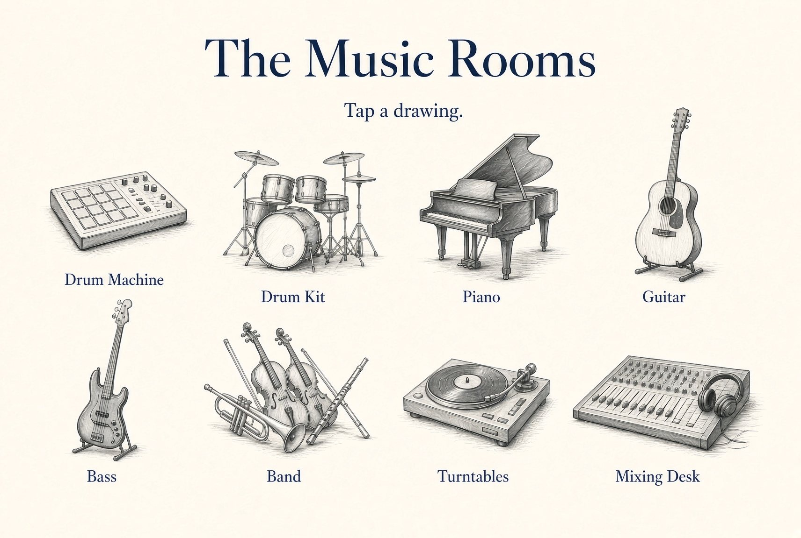

| Drum Machine | Drum Kit | Piano | Guitar |
|---|---|---|---|
| 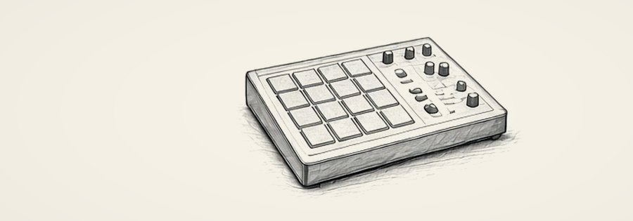 | 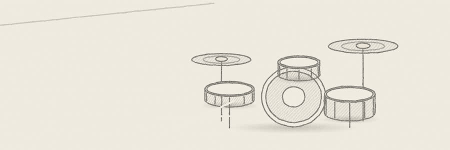 | 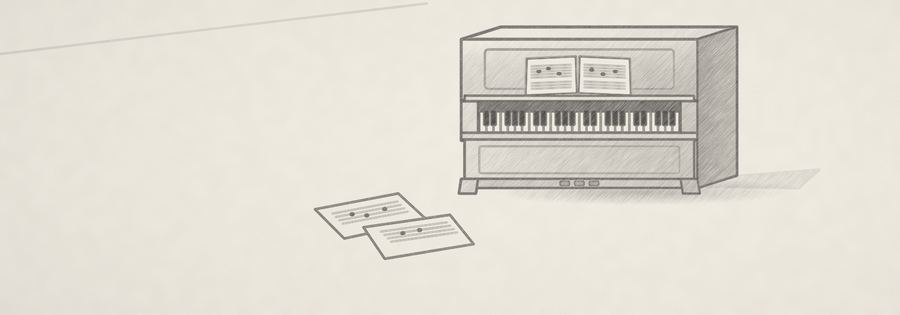 |  |
| **Bass** | **Band** | **Turntables** | **Mixing Desk** |
|  | 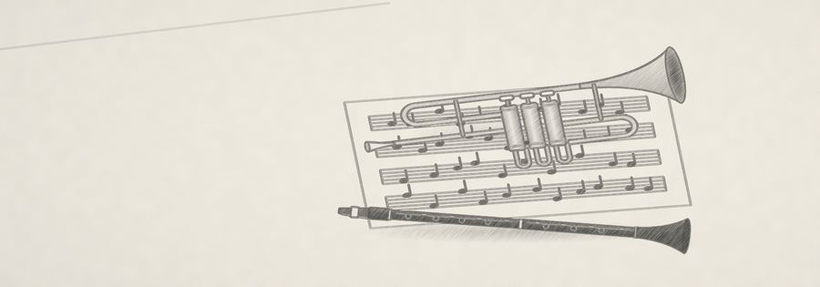 | 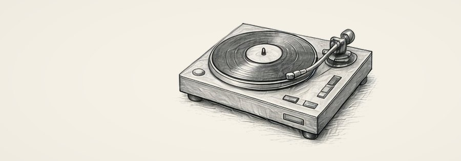 | 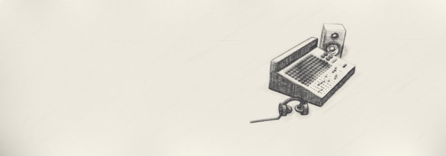 |

The Studio's own door (the Explore menu, `music-studio-pencil-*`) is the console with a speaker and headphones: the control room of the house.

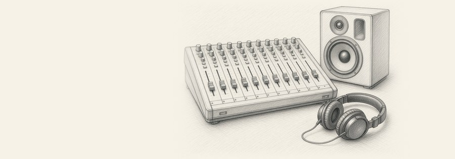

To remake a banner: crop the drawing from its sheet and multiply it onto paper `#F6F2E8`, the drawing about 84% of the banner's height and at most 46% of its width. Keep the three sizes and the names. Bump `sw.js`.

### The faces of the rooms (mockups, the direction for §05–§10)

These show the first surface of each room: the drawing at the top right, the title, one dark chassis with the instrument as the hero, and one plain line on a paper slip. They are the direction, not a pixel spec. The words on them still follow `CLAUDE.md` (plain words, English and Spanish). The approved Mixing Desk face in §10 wins over its mockup.

| Drum Machine | Piano |
|---|---|
| 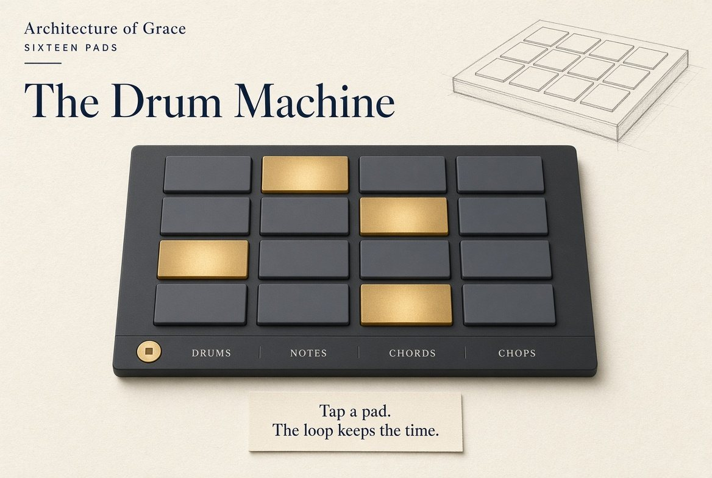 | 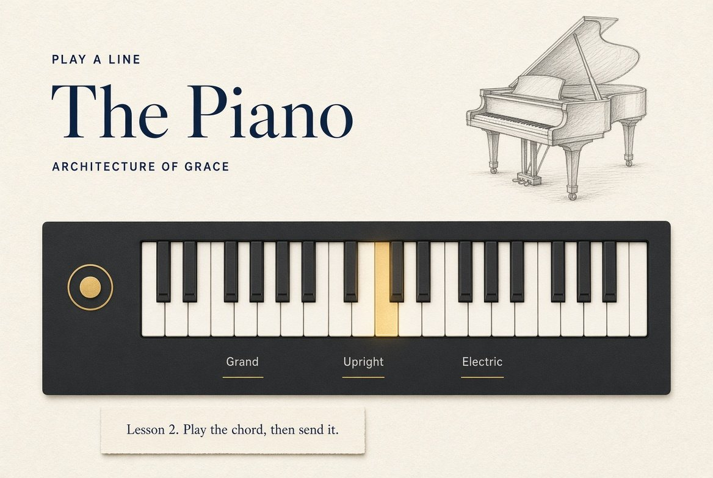 |
| **Guitar** | **Bass** |
| 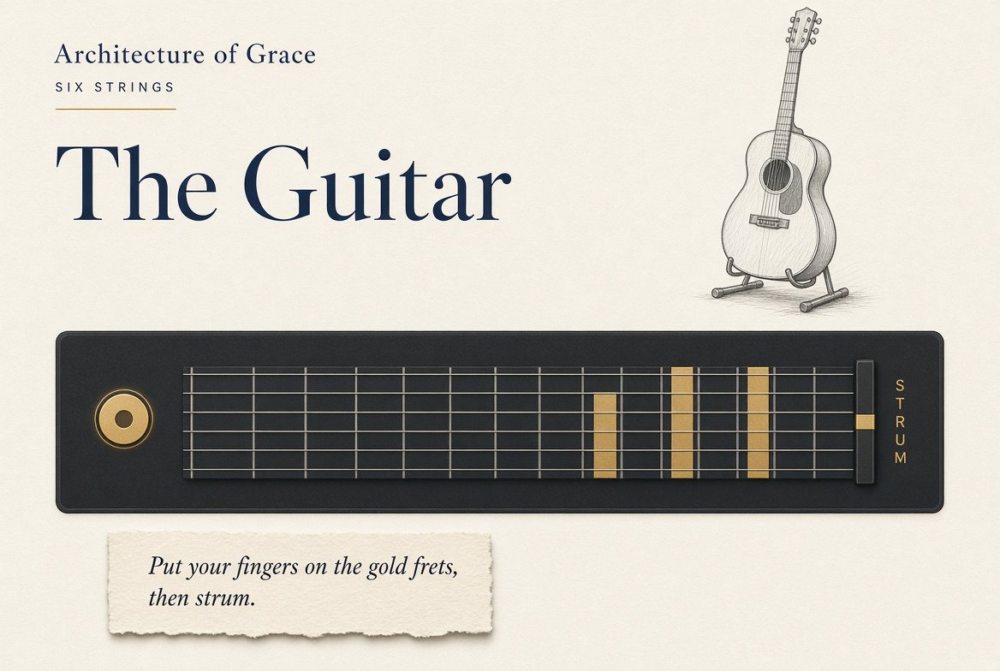 | 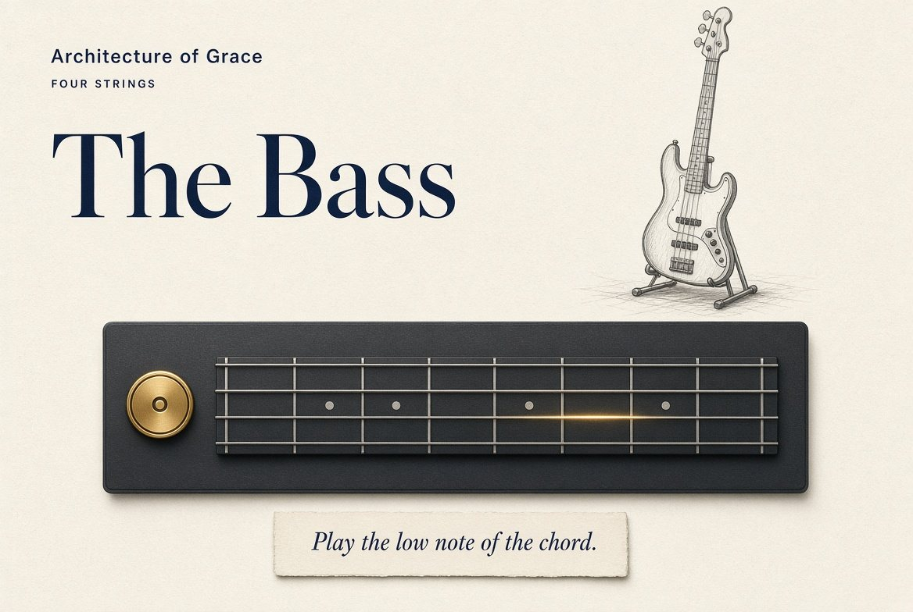 |
| **Band** | **Mixing Desk** |
| 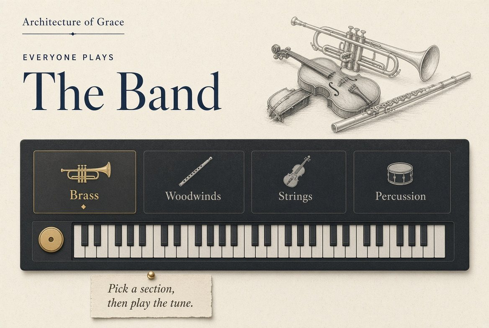 | 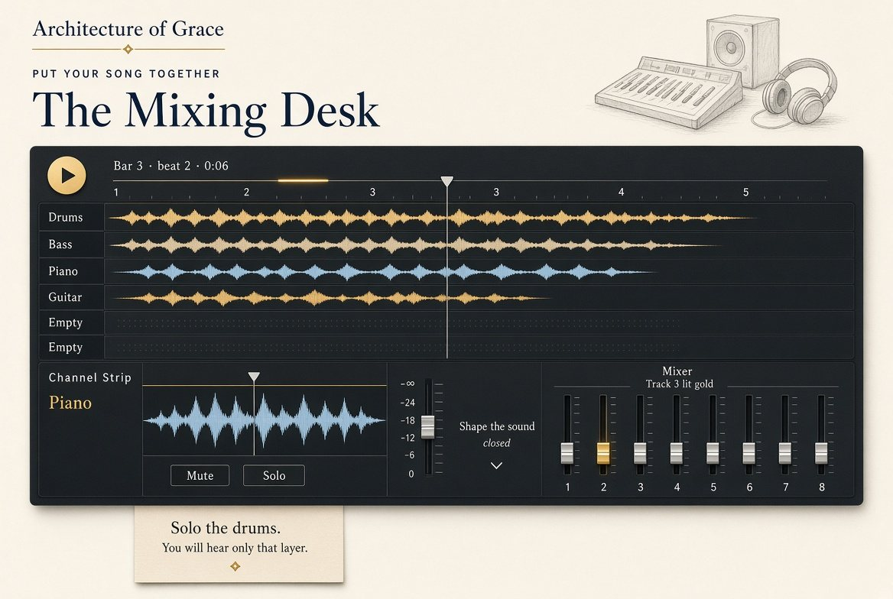 |

Why these picks:
- **Guitar:** the gold fret bars and the Strum strip show what to do. The alt (`art/mockups/guitar-alt-record.jpg`) puts a ▶ play triangle on the Record button, which reads as Play.
- **Bass:** only the fretboard and one line on the first surface. The alt (`art/mockups/bass-alt-amp.jpg`) puts five amp knobs beside it. §08 keeps the amp one step away.

### Spare drawings

Kept for later pages and print; not on the site yet.

| | |
|---|---|
| 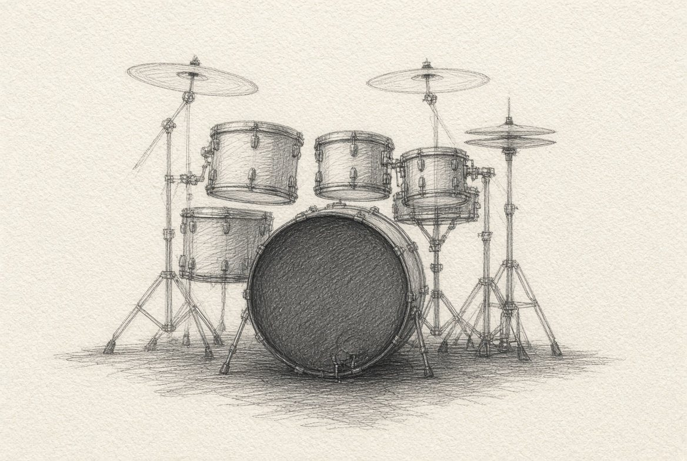 | 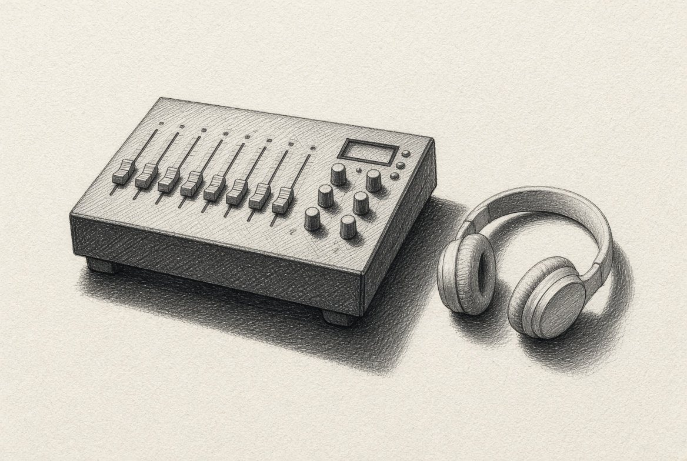 |
| 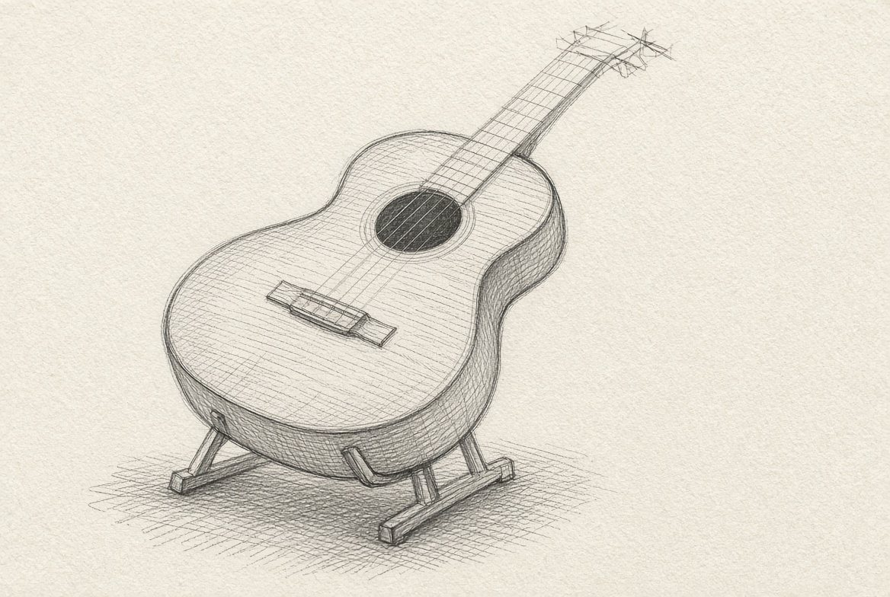 | 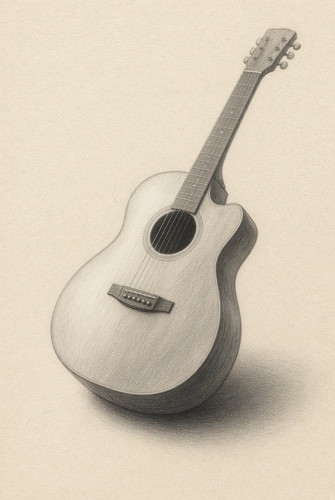 |

---

## 01 — THE PRODUCT YOU ARE ACTUALLY BUILDING

The Studio is Jimmy's instrument first. He is a musician and a maker who wants to play, chop his own records, add his voice, plug in his real guitar, mix, and send the result out. Students and children are not the design center. A learner can still use a room. Do not simplify the ceiling, the language, or the signal path to make it feel like a classroom activity.

Write the interface for a person making music. Not for a class completing one. No learning objectives on the surface. No "student should." Say "you."

The public aim is word of mouth, not a campaign. The Studio should be the best free recording studio a person can stumble into from a link a friend sent. No account. No trial. No email gate. One address. You play, you record, you leave with a file. That is what gets told to the next person. Do not build a growth funnel. The work is the marketing.

The product is:

THE STUDIO

A creative environment inside Architecture of Grace where you can:

PLAY → MAKE → PLUG IN → ADD A LAYER → LISTEN → CHANGE → MIX → SEND IT OUT

The instruments are the rooms.
The Studio is the house.
The Mixing Desk is the control room, not the house.

The user should understand that distinction immediately.

---

## 02 — THE CORE PRODUCT IDEA

One world.
Eight rooms.
One project.
One consistent interaction philosophy.

The Studio should feel like a place you can enter and think:

"I can make something here."

Not: "Which educational activity am I supposed to complete?"
Not: "Which webpage am I on?"
Not: "What does all of this software do?"

Exploration first. Explanation second.

---

## 03 — DO NOT EXPAND THE PRODUCT

This is a coherence phase, not an expansion phase.

Do not begin by adding instruments, effects, lessons, controls, kits, or decorative elements.

The existing system is already rich enough. The next increase in value comes from integration, hierarchy, clarity, and flow.

Before anything new is added, ask: does this materially improve the experience of creating music? If not, do not build it.

Explicit exceptions Jimmy asked for, already in scope: a voice slot, chops from his own records onto the Drum Machine, Send it out, and a real guitar into the desk. Do not treat those as expansion. Build them.

---

## 04 — THE PRIMARY ARCHITECTURAL MOVE

Create one Studio shell.

Route decision, already made. Do not reopen it:

- `/the-studio` is the new flagship shell.
- `/studio` and `/mixing-desk` stay the Mixing Desk until a later, explicit redirect migration. Both currently serve `music-studio.html`. Internal names (`studioinbox`, `studiobench`, `AOG-STUDIO-*`, the `studio/` tests) stay.
- Existing room routes stay live and bookmarkable:

```
/drum-machine
/drum-kit
/guitar
/bass
/piano
/band
/turntables
/mixing-desk
/studio          ← still the desk, for now
```

From the shell, those routes should feel like changing rooms, not leaving the product. Implement that as a persistent shell with the active room as the workspace. A direct hit on `/bass` may keep serving the bass page in this phase, but the shell, the lab doors, and the project strip must make it feel like the same house. Do not break existing links to buy a cleaner URL.

Do not collapse eight audio graphs into one mega-page in this phase. A unified Studio means one coherent environment that reveals the right room. It does not mean every control from every page on one screen.

Generated pages stay generated. If you must change guitar, bass, or band, edit the source and regenerate.

---

## 05 — THE STUDIO SHELL

One persistent frame.

```
ARCHITECTURE OF GRACE

THE STUDIO
Play · Make · Listen · Change · Mix

DRUMS   KIT   PIANO   GUITAR   BASS   BAND   TURNTABLES   MIX
────────────────────────────────────────────────────────────

                    ACTIVE ROOM

                 [CURRENT INSTRUMENT]

────────────────────────────────────────────────────────────

MY TRACK
Drums —   Kit —   Piano —   Guitar —   Bass —   Band —   Turntables —   Voice —
Live guitar —   Live bass —
```

The exact visual treatment is yours. The principle is not:

Switching instruments feels like changing instruments inside one studio, not navigating to another website.

The shell is shared. The rooms are not clones.

Lab doors remain the way a student moves. Do not replace them with a wall of tabs. `CLAUDE.md` already forbids a row of four or more section choices as buttons, with the music lab doors as the explicit exception.

---

## 06 — ONE PROJECT: MY TRACK

This is the most important conceptual upgrade.

The maker is not independently using eight tools. They are building one thing: My Track.

Possible layers, in song order:

Drums, Drum Kit, Piano, Guitar, Bass, Band, Turntables, Voice, then Mix.

Bind My Track to the shelves that already exist. Do not invent a second save system.

What a checkmark means, exactly:

- A layer is present when that room has a take in `studioinbox`, or a bounce on its shelf that the desk can load.
- Visiting a room does not check the layer.
- "Add a layer" sends the current take through the existing Send path, then returns the student to the project, not to a new website.
- The desk reads `studioinbox` as it does now. Newest first. Cap 16. Do not silently drop a take without naming what was pushed out.

The purpose of every room becomes obvious: I am adding a piece to something I am making.

---

## 07 — THE UNIVERSAL USER JOURNEY

This path should feel natural. It matters more than any button.

PLAY — touch the instrument.
MAKE — a pattern, a part, a progression, a performance.
ADD A LAYER — bring it into My Track.
LISTEN — hear what you have.
CHANGE — revise.
MIX — open the control room.
SAVE — keep the creation.

A student should never feel they are navigating a technology stack.

---

## 08 — PROGRESSIVE DISCLOSURE

Do not remove sophisticated functionality. Control what is visible when.

A student opening a room sees the creative surface first.

```
PLAY        the instrument
BUILD       pattern / chords / sequence
ADVANCED    deeper controls, one disclosure away
LEARN       optional, closed by default
```

Controls differ by room. The mental model does not.

Simple to enter. Deep to explore.

The amp, pedals, EQ, Solo mode, swing, Sound dial, kit menus, and deck pads stay. They do not sit on the first surface at equal weight.

---

## 09 — EACH ROOM KEEPS A DISTINCT ROLE

Same building. Different rooms.

DRUM MACHINE — rhythm, percussion, sequencing.
The pad and the grid stay highly prominent. Tap a sound. Build a pattern. Change it. Add it to the track. Do not bury the pads under controls. This is `music-pads.html`, not the retired machine.

DRUM KIT — a kit you play with your hands.
Its own room. Recorded kits, drawn as kits. Do not fold it back into the Drum Machine.

GUITAR — instrument, expression, tone.
It should feel like something someone wants to play. Amp and pedals support that. They do not lead.

BASS — groove, foundation, low end.
Not a smaller guitar. The relationship to rhythm should be obvious in the playing, not in a caption.

PIANO — harmony, melody, keys, sound palette.
Playing first. Sound choice and advanced controls behind that.

BAND — harmony, composition, musical structure.
Do not flatten chords, keys, progressions, scales, or arrangement. Make an accessible entry into them. Sophistication stays discoverable.

TURNTABLES — performance, manipulation, DJ workflow.
Tactile. The path is load → play → cue → chop → manipulate → loop → mix. Three decks stay. Sophisticated is allowed. Confusing is not.

A student can load their own record. From that record they can cut chops. Those chops are not trapped on the decks.

BRING CHOPS TO THE DRUM MACHINE — required path, not a later idea.

The move is: I cut this from my record. Put it on the pads.

- On the Turntables, after a chop or a take is made from the student's own record, the next action is visible: Send chops to the Drum Machine.
- "Own record" means a file the student loaded on this device. It stays on this device. Nothing is uploaded to make the chop.
- The chop arrives on the Drum Machine's chops bank, ready to hit, not in a file picker and not on the retired machine.
- Use the path that already exists. A take goes to `studioinbox` (where the Drum Machine already finds takes to chop) and a note on `padstake` tells the Drum Machine to put it on the chops bank. Do not invent a second sample bus. `drumsample` remains the shelf for a take sent onto one pad.
- Sixteen chops is the existing cut: one beat each from the bar picked, or sixteen equal parts when tempo is unknown. Keep that. A single chop the student marked can also land on one pad.
- Name the chop after the record, in plain words. The student can rename it.
- Sending does not leave the Studio. After the send, the student can open the Drum Machine with that chops bank already in front of them.
- The pads stay the first surface. A new chop does not bury the kit under an import panel.

MIXING DESK — production, arrangement, balance. The control room.
Its job is: what did I make, and how do I bring it together?
It is the destination, not another instrument.

---

## 10 — THE MIXING DESK IS A DESTINATION

Do not treat it as another instrument page, and do not redesign the face that was already approved.

Approved face, non-negotiable:

- Cream paper.
- Pencil console drawing as the banner.
- One dark chassis.
- Song lanes with waveforms as the hero.
- One open channel.
- Eight short faders.
- The lesson as a paper slip.
- The phone mock that drifted is not the spec.

Mental model:

```
CONTROL ROOM
Your track is here.

01 DRUMS
02 KIT
03 PIANO
04 GUITAR
05 BASS
06 BAND
07 TURNTABLES
08 VOICE
```

Track 08 is the voice slot. It is empty until the student adds a voice. It is not a spare instrument channel and not a hidden bus.

What "add voice" means:

- The student chooses it. The microphone never opens on load, on play, or in the background.
- First use asks for the microphone in plain language, English and Spanish: "To add your voice, this page needs the microphone. The recording stays on this device."
- A take is the student's voice only, captured after an explicit Record. Stop ends it. Delete works the same way as other takes, including Bring it back until the next delete.
- The take lands in My Track on channel 08 and in the same local save as other layers. It does not upload. There is no account and no backend in this phase.
- Listen plays it with the other layers. Mix can level it, mute it, and solo it like any other channel.
- If the browser or the school device refuses the microphone, the slot stays, with a plain line and a way to try again. The rest of the Studio still works.
- School-device reality: many Chromebooks block the mic. Do not make voice required for the three-second test or for making a track.

The existing instrument recorder stays what it is: the tool's own sound, never a microphone, three takes. Do not bolt the mic onto every room's Record button. Voice has its own slot, its own Record, and its own channel.

Privacy is part of the slot. Say where the recording lives. Do not send it to a sheet, a server, or the turntables crate unless he explicitly sends that take the same way he sends any other take.

## 10b — PLUG IN A REAL GUITAR

Jimmy wants to hook his real guitar into this studio. This is a required path, not a later idea.

The on-screen guitar stays. This is the other guitar: the one in his hands, through a cable.

What the browser can actually do. Say it plainly on the page, once.

- A browser cannot see a quarter-inch cable. The guitar has to reach the computer as an audio input. That means a USB interface, a USB guitar cable, or a microphone in front of an amp. Name those three. Do not pretend a bare 1/4 inch plug works.
- First use asks for the input. The input never opens on load. Plain line, English and Spanish: "To record your guitar, this page needs the input. The recording stays on this device."
- Turn processing off on the capture. `echoCancellation`, `noiseSuppression`, and `autoGainControl` false. Those are for calls. They wreck a guitar.
- Offer the input list when the device has more than one. Remember the last choice on this device.
- Monitor through the amp and pedals that already exist (`aog-amp.js`, `aog-amp-worklet.js`). The real guitar should be able to use the same heads, cabinets, and pedals as the on-screen guitar. Dry in, tone on the way to the speakers.
- Record the dry input and the toned signal. The dry take is the one he can re-amp later. The toned take is the one that goes on My Track. Do not keep only the effected sound.
- Arm the Guitar channel, or a Live guitar lane if the on-screen part is already there. Count in. Record. Stop. It lands on My Track like any other take. Delete works the same way.
- Bass uses the same input path and the bass amp. Do not build a second capture engine.
- Latency is part of the product. Show it if you can measure it. If monitoring through the page is late, say so, and say that direct monitoring on the interface is the zero-latency path. Do not hide a late signal behind a pretty meter.
- A missing interface does not break the Studio. The on-screen guitar still plays. The slot stays, with a way to try again.
- Nothing uploads to record. The take stays on the device until he sends the file out.

The test is not a demo tone. The test is: cable in, a chord, hear it through an amp model, stop, the take is on the desk.

## 10c — A FREE GUITAR TUNER

A tuner is part of the studio, not a separate product and not a paid add-on. No account. It sits one tap from the real-guitar input and from the Guitar room.

- It listens to the same input as the real guitar: interface, USB cable, or mic. It never opens that input until he chooses Tune.
- Standard guitar first: E A D G B E. Then drop D, half-step down, and bass E A D G, behind one menu. Do not lead with a wall of tunings.
- Show the note, how sharp or flat, and a calm needle or cents number. Green when it is in. No flashing. No sound of its own.
- Pitch detection has to work on a single plucked string in a bedroom. Ignore the noise floor. Do not jump strings while a note is still ringing.
- Reference is A440 unless he sets another A. Remember it on this device.
- Tune does not record. Leaving the tuner returns him to the guitar, still armed if he was armed.
- It works with no interface, through the mic, so a person who arrived from a friend's link can tune before they have a cable.

Sends, master, and bounce stay. Bounce still lands on `studiobench` so the turntables can load it.

---

## 11 — ADD A LAYER IS A CORE ACTION

After a student makes something, the next move is obvious:

+ ADD A LAYER

Then the rooms, in song order, and Voice. Not production jargon.

Adding a room means: send this take into My Track, using the shelf you already have.

Adding voice means: open the voice slot, record, and place that take on channel 08.

Sending chops means: the cuts from the student's own record go to the Drum Machine chops bank, through `studioinbox` and `padstake`.

---

## 12 — SEND IT OUT

Saving on this device is not the finish. Jimmy wants to send the work out.

SEND IT OUT is a first-class action on My Track and on the Mixing Desk, beside Listen and Mix. It is not buried in a lesson, and it is not the same as Send to the turntables or Send to the drum machine. Those move a take between rooms. This one leaves the Studio as a file.

What it produces:

- One mixed file of My Track, WAV, stereo, the bounce you can already make, named so a person can find it.
- The voice take on its own, if there is one.
- The chops cut from his own records, as a small set of files, if he made chops.
- Optional stems, one file per occupied channel, only if the mix bounce already exists. Do not block the single file on stems.

How it leaves:

- Download, then the device share sheet where the browser has one. He should be able to hand the file to Messages, Mail, AirDrop, or a drive without an account on this site.
- No upload. No public link. No login. The site stays static and privacy-first. "Send it out" means a file he owns, not a host you build.
- A short plain line, English and Spanish: "This file stays yours. Nothing is uploaded."

The file has to be something he would actually send: loud enough to hear, not clipped, the voice in the mix if he added one, the chops he placed on the pads if they are in the track. Do not hand him a silent bounce.

Keep the in-site shelves. They are how rooms talk. They are not how the song leaves.

---

## 12b — LISTEN IS A FIRST-CLASS ACTION

At some point you can simply:

▶ LISTEN

Hear the project. Then change something. Then send it out.

The loop is Create → Listen → Revise → Send. Do not hide it behind another control change.

---

## 13 — LEARNING SITS BESIDE THE EXPERIENCE

Do not turn the Studio into a music textbook.

LEARN ▾ opens a short challenge that makes the learner do something.

Example:

MEET THE DRUM PADS
Play three sounds.
Make a four-beat pattern.
Change one sound.
Play it again.

Existing lesson pages stay where they are (`drums-lessons.html`, `mastering-drums`, piano lessons, band lessons, decks lessons). Do not paste them into the instrument surface.

---

## 14 — DO NOT OVER-EDUCATE THE INTERFACE

Architecture of Grace has a strong educational identity. The Studio does not need to explain it constantly.

Do not put learning objectives, standards, definitions, vocabulary, assessment, or reflection on the instrument surface. That material lives in its own rooms when it is needed.

The student learns by experimenting, repeating, listening, comparing, revising, and creating.

Grace over performance lives underneath the experience: try something, hear it, change it, try again, keep going. No penalty for experimentation. Do not turn that into a caption on every control.

---

## 15 — VISUAL LANGUAGE

One language across the shell:

- type hierarchy
- spacing
- navigation
- button behavior
- focus states
- play / stop
- record
- save
- status
- drawers
- responsive behavior

Rooms keep their personality. The shell is coherent. The instruments are not clones.

Words a student reads in order to use the Studio are plain, in English and Spanish. Short sentences. Everyday words. Warm and direct. Rewriting never changes a fact, a promise, or a privacy claim. Leave lesson and curriculum copy alone.

Readable text, always. No cream on a white box. No dark text on navy. Light and dark. `aog-grace.js` paints the masthead navy with cream text. Anything with its own light background inside the masthead gets dark ink (`data-aog-card`). Close every `<header>` before the body.

---

## 16 — VISUAL HIERARCHY

Priority, in order:

1. The creative surface. The thing the student plays.
2. The primary action. Play / create.
3. Building. Pattern, chord, sequence, layer.
4. Supporting controls. Tempo, sound.
5. Advanced controls.
6. Learn. Optional.
7. Save / record / add a layer.

Equal visibility is not usability. Do not give every control the same weight.

---

## 17 — ACCESSIBILITY AND CALM

Accessibility is a design requirement, not a pass at the end.

Audit keyboard, focus, semantics, text alternatives, touch target size, contrast, motion, audio-only information, screen readers, tablet, Chromebook, mouse, and no-mouse.

Also apply the standing calm rules, already enforced in this repo:

- Load `aog-calm.css`.
- iPhone first, then iPad, then computer.
- No endless animation. Nothing that moves on its own. No surprise sound.
- No page-change fade. `@view-transition` stays `navigation: none`.
- Fields at 16px or larger, so iOS does not zoom on tap.
- Touch screens and `prefers-reduced-motion` get no decorative motion.
- Computer pages show at 85% except pages with a canvas, which draw at full size so a pen lands under the finger. Do not change that shared rule. Play views already opt out with `body.aog-play { zoom: 1 !important }` in the page's own CSS.
- Neuro-affirming words. Describe what a learner can do. Never deficit labels.

Before any push:

```
node tools/check-contrast.js <pages>
node tools/check-calm.js <pages>
```

Name pages as they sit in `aog-deploy/` (`music-band.html`, not `aog-deploy/music-band.html`). After a shared file (`aog-grace.js`, `aog-grace.css`, `aog-topbar.js`, `aog-labdoors.js`, `aog-handoff.js`, `aog-recorder.js`), run both with no arguments. Do not push while either fails. Fix the page. Never loosen the check.

---

## 18 — RESPONSIVE

Design for use, not for a desktop screenshot.

Test desktop, laptop, Chromebook, tablet, touch, keyboard, mouse.

Sideways play views already exist for guitar, bass, piano, drums, and band. Portrait stays as it is. Do not regress `LANDSCAPE-HANDOFF.md`. iOS Safari cannot lock orientation. A web page cannot stop the system swipe from the top edge. Keep the playing surface clear of the notch, the home bar, and the top buttons.

The instrument remains the dominant experience. The interface adapts. It does not merely shrink.

Do not use browser zoom or a screenshot scale as a specification.

---

## 19 — PERFORMANCE

Performance is part of the experience.

Audit audio latency, loading, state transitions, rerenders, memory, asset weight, and time to first sound.

A pad hit should feel immediate: action, then response. Any noticeable delay weakens the room.

Recorded kits and sample sets already load only when picked. Keep that. Do not prefetch the whole library to make the shell feel "ready."

---

## 20 — INVENTORY BEFORE YOU CHANGE ARCHITECTURE

Document what already works, then decide what is preserved, reorganized, refactored, or replaced.

Preserve unless a change is required for the shell or My Track:

- audio engines (`aog-amp.js`, `aog-amp-worklet.js`, `aog-dj.js`, `aog-vinyl-worklet.js`, `aog-drumkit.js`, `aog-solo.js`)
- shelves and inbox
- recorder and Send buttons
- loudness standard
- generated-page pipeline
- lab-door order
- sideways play views
- Spanish strings
- credits in `audio/*/CREDITS.txt`

Do not rebuild a room because a rewrite would be cleaner. The goal is a better product, not a prettier codebase.

Global scope warning: these pages share one global scope. Never reuse a function name. A previous collision (`realKit`) made every made kit play as a recorded kit.

---

## 21 — DO NOT CHASE FEATURE PARITY

The instinct during consolidation will be to put every control from every page on the unified page.

Do not.

A unified Studio is one coherent environment that reveals the appropriate tool when needed. That distinction is the work.

---

## 22 — THE THREE-SECOND TEST

Every Studio state must pass:

- 3 seconds: do I know what this is?
- 10 seconds: do I know what to touch?
- 30 seconds: have I made a sound?
- 2 minutes: have I created something?
- 5 minutes: have I found something deeper?
- 10 minutes: do I want to keep going?

If not, redesign that state.

---

## 23 — THE NO-EXPLANATION TEST

A student should be able to enter with no adult explanation and begin doing something useful.

The first action must be obvious. Depth can be discovered.

---

## 24 — THE WHY DOES THIS EXIST TEST

For every major control: why does this exist, how does it help the student make something, and is it visible at the right moment?

If the answer is unclear, hide it, simplify it, combine it, or remove it from the first surface. Do not keep interface complexity because the feature is technically interesting.

---

## 25 — THE ARCHITECTURE OF GRACE TEST

This is still Architecture of Grace. It should not become generic music software.

Underneath, not on the chrome:

try something, hear it, change it, try again, keep going.

No penalty for experimentation. No requirement to get it right the first time.

GRACE OVER PERFORMANCE, without turning every interaction into an SEL lesson.

---

## 26 — THE FINAL EXPERIENCE

```
ENTER THE STUDIO
        ↓
MAKE A SOUND
        ↓
MAKE SOMETHING
        ↓
ADD A LAYER
        ↓
LISTEN
        ↓
CHANGE IT
        ↓
ADD ANOTHER LAYER
        ↓
OPEN THE CONTROL ROOM
        ↓
MIX
        ↓
SEND IT OUT
```

---

## 27 — SUCCESS CRITERIA

The work is done only when all of these are true:

1. The eight rooms feel like one product.
2. A first-time session can make a sound almost immediately.
3. Advanced function is still there: amp, pedals, Solo, swing, kits, three decks, sends, bounce.
4. You can see how one room relates to another.
5. My Track is one project, backed by the existing shelves, and a checkmark means a real take. Voice is a real slot on channel 08, opt-in, local, and not required to finish a track.
6. The Mixing Desk feels like the destination, and the approved face is intact.
7. Sophisticated, not intimidating. Not written down for children.
8. Contrast check and calm check pass. Keyboard, touch, and no-mouse paths work.
9. Visually memorable, not decorative clutter.
10. A future room would extend the Studio, not create another standalone product.
11. Existing Send, inbox, bounce, and `studio/send` behavior still pass.
12. Drum Kit is still its own room. The retired drum machine is still retired.
13. A chop cut from your own record can be sent to the Drum Machine and played on a pad, with no upload and no new shelf.
14. Send it out produces a WAV he can share from the device, with no account and no upload.
15. A real guitar, through an interface, can be monitored through the existing amp and recorded onto My Track. A missing interface does not break the page. A free tuner is one tap away, works from the same input or a mic, and does not record.
16. A stranger can open the Studio from a link, with no account, and leave with a file. That is the word-of-mouth test.

---

## 28 — THE CREATIVE STANDARD

Do not ask "is this better than the current version?"

Ask what the best product, interaction, education, music-tech, accessibility, and frontend people would refuse to compromise on, given this exact starting point.

Be ruthless about unnecessary complexity, inconsistent patterns, weak hierarchy, redundant UI, unclear state, extra clicks, confusing terms, dead space, visual noise, inaccessible interactions, and disconnected rooms.

Protect playfulness, experimentation, musical depth, discovery, tactile playing, personality, and student agency.

---

## 29 — DO NOT MAKE IT CORPORATE

Polished, not sterile.
Not enterprise software.
Not a district purchasing portal.
Not a DAW stripped down for children.

Human, musical, calm, inviting, smart, creative, alive.

The sophistication comes from craft, not from more controls.

---

## 30 — OUT OF SCOPE FOR THIS PHASE

- New instruments, effects, lessons, kits, or amps. Voice is a slot on the desk, not a new room.
- Accounts, cloud save, or a backend. The site is static and privacy-first. Project state stays on the device. Voice stays on the device.
- A second save system beside the shelves.
- Renaming `/studio` away from the desk in this phase.
- Editing generated HTML by hand.
- Re-merging `claude/amp-*`.
- Putting standards, objectives, or reflection on the instrument surface.

---

## 31 — HOW TO PROVE IT

Tests live in `music-handoff/tests/`. Run the relevant suites, then the send suite. Each suite has a fixed port. Never run two copies at once.

```
bash music-handoff/tests/run.sh studio/send
node tools/check-contrast.js <pages>
node tools/check-calm.js <pages>
```

Playwright and Chromium are already installed globally. Never run `playwright install`.

Add a shell suite that proves:

- `/the-studio` opens on a room whose first surface is playable.
- Moving to Bass does not drop My Track.
- Add a layer writes through the existing inbox.
- Voice Record does not open the microphone until the student chooses Add voice, and a refused mic does not break the page.
- A chop sent from the Turntables shows up on the Drum Machine chops bank and can be played.
- A direct visit to `/bass` and `/mixing-desk` still works.
- English and Spanish.
- iPhone, iPad, and computer.
- Light and dark.
- No page errors.

Nothing here can run real Safari. Say so. Ask Jimmy to try the shell on his iPhone and iPad after it ships.

Deploy, only after the suites and both checks pass:

1. Bump `const CACHE` in `aog-deploy/sw.js`. Next `m729x`-style value, one ALL-CAPS comment saying what changed, old line kept as a comment.
2. Commit. No model names in the message except the two attribution lines the repo already uses, if that workflow is still in force.
3. Open a PR to `main`. Do not force-push `main`.

---

## 32 — FINAL DIRECTIVE

You are not being asked to make more.
You are being asked to make what already exists feel inevitable.

Take the existing rooms:

Drums. Kit. Piano. Guitar. Bass. Band. Turntables. Mixing Desk.

Turn them from a collection into a system.

ONE STUDIO
ONE PROJECT
ONE CREATIVE FLOW

The student should enter and understand:

I can play here.
I can make something here.
I can build on what I made.
I can finish something here.

That is the product.

NON-NEGOTIABLE NORTH STAR

PRESERVE THE SOUL.
SIMPLIFY THE PATH.
RAISE THE CEILING.

Do not chase more features.
Do not redesign for the sake of redesign.
Do not flatten the rooms.
Do not sacrifice depth.
Do not accept "good enough."
Do not rebuild the engines to get a cleaner shell.

Make the existing work feel like one extraordinary place.

THE STUDIO
Play. Make. Listen. Change. Mix. Create.

---

## 33 — SINCE THIS WAS WRITTEN

- **2026-10-23 · 🎙 The Vocal Booth's More sounds (AOG-VOCAL-FX-V2; aog-vocal.js, music-vocal.html, music-studio.html's `snd` list; no cache bump here).** Jimmy: "what other effects could be added to the voice. IT IS THE COOLEST." Nine more sounds in a fold under the first nine, **More sounds / Más sonidos** (`#vbMore`; closed on a phone, open from 700 px), and three more controls in Shape your voice.
  - **Sounds (EN · ES, one line each):** Deep · Grave ("A lower, bigger voice"), High · Aguda, Harmony · Armonía ("A second voice sings with you"), Wide · Amplia, Slapback · Rebote ("One quick echo, like the 1950s"), Megaphone · Megáfono, Old record · Disco viejo, Ghost · Fantasma ("Echoes rise before each line"), Chop · Cortes ("Cut in time with the beat"). `snd` names: `deep high harmony wide slap mega old ghost chop` (the desk's `cleanClip` keeps them). **Controls:** Grit · Garra (drive, any sound, live), Pitch · Tono (−12 … +12), Harmony · Armonía (level, live) and Harmony note · Nota de la armonía (a third or a fifth up).
  - **How:** Pitch, Deep (−5), High (+5) and Harmony are made ahead in a Worker built from `FXW`'s own text (main thread if Workers fail): YIN every 10 ms, one pitch mark per period placed by likeness to the period before, TD-PSOLA with asymmetric raised-cosine grains and 4-point interpolation, the level put back where there is a note; formants follow the new pitch part way (`FMT` 0.55) for Deep and High, not for the harmony. Harmony is diatonic in `AOGSong`'s key (the key's note nearest the voice, two or four steps up, a median over 13 periods), its s sounds at 35 %, played as a second source into the same chain (`o.h`, level live). Ghost is the take through a 1.5 s room turned backwards (OfflineAudioContext convolver, read L−1 samples on). Old record's crackle is baked into the prepared take (seeded, about 7 soft pops a second, −37 … −44 dB under the voice's peak). Slapback (108 ms, one tap, 220 Hz–3.4 kHz), Wide (four drifting copies hard left/right, lows kept in the middle), Megaphone (420 Hz–5 kHz horn with Grit 70), Old record's band and wow (170 Hz–3.6 kHz, 0.55 Hz ±1.2 ms) and Chop (a gain at the end of the chain on every sixteenth from the take's bar, open 55 %, 3 ms / 8 ms edges) are in `chain()`, the same for ▶ Hear it and + Add. `prepared()` now keeps three stages per take (`memo`: Soft S + Tune; Pitch + Harmony; Ghost + crackle) and returns `{x, h}`; `shapeOf(P)` says when the chain must be made again as it plays. The Worker is let go when the booth rests.
  - **Test** `studio/vocal.js` measures each on the pretend 226 Hz voice: Deep 169.3 Hz (−5.00 st, steady within 2–3 cents), High 301.7 Hz (+5.00 st), Pitch +3 268.8 Hz, both the same length and timing; Harmony 22 % of the lead's power at 268.8 Hz (A → C in C major) and 0.01 % at the major third, a fifth 12–13 %; Megaphone 0.7 % below 250 Hz, 0.04 % above 6 kHz, new harmonics above 4.6 kHz 25× those without Grit; Grit 80 on Clean 50×; Slapback one echo at ~105 ms (measured on 5 ms frames), nothing after it; Chop's shut parts 0.00 % of its open ones on the song's grid; Ghost 36–37 % before each line (Clean 0.00 %); Old record 0.00 % above 6 kHz, a 16-cent wow, 0.15 % crackle in the gaps; Wide side 32–37 % against Double's 9–13 %; every sound ≤ 0.890 peak; the fold, its words and 44 px keys on an iPhone and an iPad; take 2 goes to My Track as Harmony (iPhone, ES) and Ghost (iPad, EN). The pitch finder in the test now takes the shortest period that fits as well (not an octave low).
  - Not done: "Hear myself" while recording stays as it was (a light room, no sound), so the mic path (AOG-VOCAL-MIC-V2/V3) is untouched; no formant (voice colour) control of its own.

- **2026-10-23 · 🎙 The Vocal Booth, the ninth room (AOG-VOCAL-V1; music-vocal.html and aog-vocal.js (new); the-studio.html via make_studio_page.py, aog-labdoors.js, every room's head line, _redirects /vocal-booth /vocal /booth; cache m7564).** Jimmy: "a vocal studio to record our voice with various effects and eq … better than the SING OR RAP icon door". It is a room of its own, just before the Mixing Desk, and the 🎤 Sing or rap key and aog-micbooth.js are gone.
  - **Sounds:** Clean, Warm, Radio, Rap, Echo, Big hall, Tuned, Robot, Phone (and Your own once a knob moves). **Knobs in plain words:** Low cut, Body, Presence, Air, Even it out (compressor), Soft S (de-ess), Tune (the desk's `dmTune`), Double, Echo (at the song's tempo), Room, Level. One chain (`chain()`) serves the live monitor and the offline render, so what you hear is what lands.
  - **Recording:** over My Track's backing (`voiceBacking`), through an AudioWorklet lined up for the device's delay; up to 8 takes, drop and bring back; "Hear myself" is a choice (headphones). The meters run only while recording or playing.
  - **+ Add to My Track** puts the take on track 8, the Voice layer (`voicePut`), dry copy beside it so the sound can be changed later; `music-studio.html` accepts the nine sounds and `custom`.
  - Test: `music-handoff/tests/studio/vocal.js` (a pretend voice with an "s": each sound and knob measured, takes, sideways, a refused mic, rest). `studio/micbooth.js` is gone with the old booth.
- **2026-10-23 · The Drum Machine's pads light by family (AOG-PADS-STAGE-V1, AOG-PADS-KEY-V1; music-pads.html, aog-drumkit.js `family()`, music-kit.html).** Jimmy: "the pads to be enhanced … the production does the work", kept calm. Each pad glows in its family's colour where the finger landed (low, snap, shimmer, metal, skin, wood, note, chop), a small lens marks the pad, the steps take the colour of the pad chosen, and a one-line colour key sits under the pads (EN/ES). No blur, no transform, no layout read at full strength, so `pads/bars16.js` keeps its margin.
- **2026-10-22 · Missions, remix challenges and "Why it works": a reason to come back (AOG-MISSIONS-V1; new aog-missions.js; the-studio.html via make_studio_page.py; aog-recorder.js, aog-song.js, aog-micbooth.js, aog-listenback.js, aog-quickstart.js; cache m7557).** Jimmy wants the Studio to make his 13-year-old fall in love with making music; nothing is ever locked. **Twelve missions**, each an "I can…" line (EN, ES) with How and "Why it works" (a one-line producer tip in plain words), ticked by what the teen does, in any order: started (✦ Start a song), playedalong (a tap or key in a room while ♫ Play along plays), recorded (a room's take), added (+ Add to My Track), listenedback (▶ Listen back or ▶ Listen), sang (a booth take), lick (`REC.addTake`), songchanged (♩ Song, or a room's tempo or key changed by hand), ownbeat (a Drum Machine step), mixed (a fader or mute at the Mixing Desk), shared (Share it, ✉ Send to a friend), remixopened (a friend's beat link). **One event:** window `aog-studio-did` {detail:{what}}; rooms fire it on their own window and the Studio passes it on; any build may fire it. **Ticks** saved at once in `aog.studio.missions.v1` ({done, ch}) by the Studio page, before aog-missions.js is fetched; only the sheet's **Start the missions again** (it asks first) clears them (the front page's Clear all saved data / Delete everything also clears them, as it promises). **Celebration:** one paper slip at the top of the room's window, a small tick, "Mission done: …" and "Next: <how>"; no animation or sound; it stays until tapped (or ✕) or the next Studio key; inside the booth when it is open; as Listen back's last line when that has room ("Next mission: …"), else once Listen back closes. **Sheet "Missions and challenges":** two tab keys, the 12 missions (the next one marked) and **6 remix challenges** ticked by hand ("I did it ✓", a second tap unticks). **Where:** **Missions · n of 12** on My Track's sheet on a phone and upright iPad; on the top line at 1100 px and wider; also the last line of ✦ Start a song's sheet and a key on the slip. Fetched on first need only; no timers. Shell API `AOGStudioShell.did(what)`, `.missions.count()` / `.open(tab)`; tests `AOGMissions.state()`. Test `studio/missions.js` (port 9631).
- **2026-10-22 · ✉ Send to a friend: the song as a small file, the beat as a link (AOG-SHARE-V1; aog-share.js (new), aog-listenback.js, music-pads.html, the-studio.html via make_studio_page.py; cache m7556).** Jimmy: "make a beat and then send it to my buddy to rap over it." Listen back has one new key under Play / Share it, **✉ Send to a friend** / **✉ Enviar a un amigo** (`#lbSend`); its first press fetches `aog-share.js` and opens a paper card with two choices. **Send the song**: My Track levelled as the desk's Send it out, made small in the browser with WebCodecs `AudioEncoder` (AAC 128 kb/s in an `.m4a` where the browser makes AAC, else Opus 96 kb/s in an `.m4a`, else the levelled `.wav`, e.g. an iPhone before iOS 26), our own small MP4 writer (`mp4()`), with Listen back's message; no share sheet → a download. **Send the beat**: `https://architectureofgrace.com/the-studio?beat=<code>`, the Drum Machine's banks A–C (hits, kits, instruments, key, scale, range, pattern, pad settings; `AOGPadsSetup.recipe()`), bars, tempo, swing, the song's key, title and beat name; never bank D, recordings or the artist's name; JSON → deflate-raw → base64url (a 4-bar beat ≈ 600 characters; refused over 16 KB). **Opening a link**: the shell reads `?beat=` before `?at=`, the address becomes `/the-studio#pads`; `clean()` (names by pattern, numbers clamped, at most 4000 hits each checked, 256 KB unpacked, unknown keys dropped), then `AOGPadsSetup.load(r)` checks every name against the machine's kits, instruments, scales and patterns, keeps the old beat in `aog.pads.v1.before`, sets the beat and puts the loop on My Track, so 🎤 Sing or rap has it straight away. Line: "A friend sent you a beat. Press Play to hear it, or tap 🎤 Sing or rap to rap over it." Nothing plays until a key is pressed; a broken link gets one kind line. Events on the Studio window: `aog-studio-did` `{what:"shared"}` and `{what:"remixopened"}` (the missions listen). Not yet: a button to bring back `aog.pads.v1.before`; the sender's title is not shown to the friend; untested on a real iPhone/iPad (which codec Safari makes). Test `studio/share.js` (port 9633).
- **2026-10-22 · Two more drum kits: 1960s British, muffled, and the 1970s giant room (AOG-DRUM-CRUNCH-V1; aog-drumkit.js, music-pads.html, music-kit.html, audio/drums/brit60 and giant70; cache m7555).** The last two of Jimmy's four, named by sound. Both from Virtuosity Drums (CC0). **BR · 1960s British, muffled** (Drum sets): close and middle microphones, every drum damped the way a towel on the drums sounded (a fast fall made here, `shape`), a dark top, squeezed, tape drive; a loose half-open hi-hat; a VCSL tambourine; tom and floor tom. **GR · 1970s giant room** (Drum sets): the room microphone first, then a giant room made here (`ROOM_GIANT`, 2.8 s) whose echo is squeezed hard (the room crush), so it swells after every hit; an open kick, a booming snare, big tom and floor tom, the ride (bell on an accent), a long crash. Grooves: 1960s beat group 138 (Rock), Swinging 60s shuffle 112 (Pop), Muffled toms with a fill 96 (Rock, two bars); Giant-room half-time 76, Heavy 70s riff groove 96, Big fill round the toms 88 (Rock, two bars). Build: `kits_more3.py`, `build.py --only BR,GR` (0.6 MB and 1.8 MB, loaded when picked). Levels: `LEVEL.kit` BR 10.8, GR 7.3; `KIT_LEVEL` BR -0.4, GR -0.9.
- **2026-10-22 · Two more drum kits: Thrash metal, tight, and the Crunchy beat machine (AOG-DRUM-CRUNCH-V1; aog-drumkit.js, music-pads.html, music-kit.html, audio/drums/thrash and crunch; cache m7554).** Jimmy asked for kits that sound like the records he loves, then "Do the tight thrash and the crunchy beat-machine". Named by sound on screen, never by a band or player. **TH · Thrash metal, tight** (Drum sets; MuldjordKit, CC BY 4.0, credited): a kick scooped in the middle with its beater click up and its ring cut to 0.3 s, both pedals of the recording taking turns, so double-kick runs stay clear; a snare tuned up, dry, a small tight room; tight hats, a china, the high rack tom, the ride (bell on an accent), a crash. **BM · Crunchy beat machine** (Electronic; Gogodze Phu Vol II, CC0, through its "retro" microphone; VCSL claps and tambourine): every pad through a late-1980s sampler's grit, made here (`dsp.crush`: held at 22,050 values a second with no smoothing, 12 or 11 bits; `crush` in a pad's shaping, `build.py`), tape drive and a dark top. Three grooves each, in the main beat groups (`grp`): Metal (Thrash beat 176, Gallop on the double kick 150, Half-time breakdown with a fill 130, two bars) and Hip-hop (Crunchy boom bap 90, Head-nod with the cross-stick 84, Loose and late 76, two bars); each brings its kit and waits for Play. Build: `music-handoff/tools/drumkits/kits_more3.py`, `build.py --only TH,BM` (0.9 MB and 0.3 MB, loaded only when picked). Levels: `LEVEL.kit` TH 8.1, BM 10.6; `KIT_LEVEL` TH -0.5, BM -0.6 (`pads/morekits.js --table --kittable`). The 60s British and 70s giant room kits followed (entry above).
- **2026-10-22 · ✦ Start a song in one tap (AOG-QUICKSTART-V1; aog-quickstart.js (new), the-studio.html via make_studio_page.py, music-pads.html, music-piano.html; cache m7545).** Jimmy wants the Studio to be a showstopper for his 13-year-old: open it, tap one key, pick a vibe, and in seconds a good beat, chords and a bass are playing, and the Piano's lit keys all fit. No wrong first step.
  - **Where:** a gold **✦ Start a song / ✦ Empieza una canción** key on the Studio's top line, beside the name (on a phone the name is the short "Studio / Estudio" so the key fits; two lines on the narrowest phones). It opens a paper sheet, **Pick a vibe / Elige un estilo**: six big choices with one plain line each (Trap, Drill, Lo-fi, Pop, Rock, House), Not now, Escape or a tap outside to put it away. `aog-quickstart.js` (the vibes and the sheet) is fetched on the first press only.
  - **What a vibe does:** sets the song (AOGSong: tempo, key, major or minor); the Drum Machine, out of sight (`AOGStudioShell.withRoom("pads", fn, want)`), builds a four-bar loop through its new `window.AOGPadsSetup.song(o)`: the beat on bank A, the chord pattern on bank B, a bass on bank C on each chord's root (style `kick` follows the kick drum like an 808, `eighths` rock, `pulse` pop 1 · 2& · 3 · 4&, `octave` house off-beats with octave pops), the chords' and bass's pad volumes from the vibe's `mix` so the drums lead; then Make the loop and + Add to My Track, as the buttons do. Then the Studio goes to the Piano, sets its lit scale (`window.AOGPianoScale.set`, and `aog.piano.scales.v1` for a Piano not open yet: the vibe's pentatonic, so every lit key fits every chord), starts ♫ Play along, and says "Your beat is playing. Play the lit keys — every one fits." The Play along sound wakes inside the tap (`AOGStudioShell.wake(true)`, for an iPhone) and rests again if nothing came of it.
  - **The six:** Trap `traprolls` 140, A minor, Minor groove (Am F C G), bells, synth bass following the kick · Drill `drill` 142, E minor, Epic (Em D C D), soft strings, synth bass following the kick · Lo-fi `lofi` 78, F major, Lo-fi 4 3 2 1 (B♭maj7 Am7 Gm7 Fmaj7), warm electric piano, upright bass following the kick · Pop `clappop` 108, C major, Pop 1 5 6 4 (C G Am F), grand piano, electric bass pulse · Rock `rockbasic` 112, G major, Rock anthem 1 4 6 5 (G C Em D), electric guitar, electric bass eighths · House `house` 124, C major, Dance 6 5 4 5 (Am G F G), warm synth, resonant synth bass off-beat octaves. The keys were picked so each pentatonic is all white keys. The table is `VIBES` in aog-quickstart.js.
  - **Shell hook (small, marked AOG-QUICKSTART-V1):** the key and its CSS, the script fetched on its tap, `withRoom` takes an optional `want(w)` (a room with no AOGRoomRender), `wake(on)` and `line(en, es)` exported, Play along's line clears the quick-start line when it stops.
  - Test `studio/quickstart.js` (port 9497; `QS_ONLY=pop,house` runs just those): the key on the first screen and on the top line, nothing loaded before; the sheet fits, 44 px keys, readable and calm; for each vibe on an iPhone (Spanish, dark) and an iPad (English, light): a new four-bar loop at the vibe's tempo is on My Track and on the desk's track 1, it sounds (loud, never silent), the Drum Machine holds the beat, the pattern and a bass on the chords' roots in the vibe's key, Play along is on and running, you are in the Piano, its key and lit scale are the song's, AOGSong has the tempo and key, the line says so; Stop rests the sound; no page errors.

- **2026-10-22 · ▶ Listen back: the payoff moment (AOG-LISTENBACK-V1; aog-listenback.js (new), the-studio.html via make_studio_page.py; cache m7545).** Jimmy wants the Studio to be a showstopper for his 13-year-old: when a teen has made something, one tap plays the song back on the whole screen with the artist's name and the song's title, like a real release, and lets them share it. **▶ Listen back** / **▶ Escúchala** sits on My Track's sheet (`#mtLb`; in the bar on a wide screen) and, after **+ Add to My Track** (or Add a layer), as a paper link beside the line "Added to My Track." (`#tpLbGo`; the line and the link now share a wrapper, `.tp-say`). The phone's bottom bar is unchanged. With nothing on My Track it opens nothing and the line says what to do first. The shell makes the sound inside the tap (an iPhone wants that; `AOGVU.own`), quiets the room in sight (`hush`, woken as it was on the way back), and fetches `aog-listenback.js` the first time (`AOGListenBack.open(api)`). The view is a modal `<dialog>` over the Studio (Escape and **Back to the studio** / **Volver al estudio** close it; focus goes into it and back to the My Track key; the Studio's key forwarding to the room stops at it): the first time it asks **Your artist name** (kept on the device, `aog.studio.artist.v1`; empty is allowed, then "+ Add your artist name") and the **Song title** (written into the desk's own song-name box, so `SONG.name` and the desk's files follow); ✎ Change asks again. It shows a cover drawn from the title (a two-colour gradient, two soft circles, the initials and the artist's name; the same every time, nothing moves), the title, "by <artist>", the key and tempo in small type (AOGSong), Play / Pause, a bar with the time (moves only while playing, can be dragged), and **Share it** / **Compártela**. **Playback** is My Track bounced by the desk out of sight (`backing()`, as ♫ Play along and ● Record use it), played on the Studio's own AudioContext: the screen never switches to the desk, Pause and the bar are exact, and the sound suspends whenever nothing plays (pause, end, close, hidden page, `aog-hush`). **Share it** makes the file the desk's Send it out would make, from the same bounce (the desk's `loudOfW` → `outLevel`: −14 LUFS, true peak under −1 dB → `wavBufW` at the chosen bit depth), named `<title>.wav`, and calls `navigator.share({files, title, text})` with "<title> by <artist> — made in the Recording Studio at architectureofgrace.com" (Spanish: "<título>, de <artista> — hecha en el estudio de grabación de architectureofgrace.com"). No share sheet for files: a download, and the line says where it went. When making the file took the tap's moment (Safari), the line asks for one more tap. Layouts: an iPhone upright (cover over the words), on its side and an iPad/computer (cover beside the words), safe areas, every key 44 px or more, 18 px fields, dark in both themes. `AOGListenBack.state()` and `AOGStudioShell.listenBack()` are for tests.
  - Not yet: the system Back gesture does not close it (no history entry, to keep the Studio's Back counting simple); a sideways phone hides the Studio's bar, so open it upright (it stays fine when the phone turns).
  - Test `studio/listenback.js` (port 9627): nothing on My Track says so; a Drum Machine loop on My Track; artist asked once and remembered; title, artist, tempo; it plays and the bar moves; Pause stops and rests; Play resumes; Share hands over audio/wav RIFF/WAVE named night-drive.wav with the message; no share sheet → download; Back and Escape close it with the room where it was; the link after + Add to My Track; iPhone in Spanish, iPad in English, a phone on its side; readable and calm; no page errors.
- **2026-10-22 · 🎤 Sing or rap: the vocal booth, one tap from any room (AOG-MICBOOTH-V1; new aog-micbooth.js, the-studio.html via make_studio_page.py, music-studio.html; cache m7547).** Jimmy wants the Studio to be a showstopper for his 13-year-old: hearing themselves on their own beat. **Where:** a red key, **🎤 Sing or rap** / **🎤 Canta o rapea**, in the Studio's top line beside EN | ES, so it is there in every room and never more than one tap away. Not the bottom bar: on a phone its five keys (Record, Listen, Play along, Send it out, My Track) already share 366 px; not only the My Track sheet, which is two taps. On a phone (under 700 px) the top line takes two rows: Back · Studio · EN | ES above, then **✦ Start a song** and **🎤 Sing or rap** side by side, each half the width and 44 px tall (one row squeezed the Start key to 16 px; checked at 320–430 px, English and Spanish; on a phone in Safari, under 760 px tall, the gaps tighten (every key stays 44 px), so the room keeps 62% of the screen); an iPad and a computer show it whole beside the meters. A phone on its side hides the Studio's lines (the room takes the screen), so the key is reached upright; a booth already open stays open and lays out in two columns when the phone turns.
  - **The booth.** The first tap fetches aog-micbooth.js (nothing before), and the booth opens over the room, dark like the control room, the room quiet behind it (`AOGStudioShell.quiet`). One line the first time only: "Headphones help: then the mic hears only you." (`aog.micbooth.v1`). A big ● Record / ■ Stop 0:07, a level meter (moves only while recording, falls back gently, rests at zero), the four sounds as big paper keys (Clean / Limpia, Echo / Eco, Tuned / Afinada, Phone / Teléfono, each with a short line of what it does), ▶ Hear it, Try again, + Add to My Track. Escape or Close puts it away, the keyboard back on 🎤; keys never reach the room behind it.
  - **Recording (the reliable way).** In the Studio page, on its own sound (registered with `AOGVU.own`), as ♫ Play along plays: the desk out of sight is hushed and its sound suspended, so it is not asked to record; it only puts My Track together (`__aogStudio.voiceBacking()`, offline, cached like `backing()`, without track 8 so the voice being replaced is not under the new one) and takes the finished take (`voicePut`). The microphone is asked for only when Record is pressed (getUserMedia, echo cancellation on, as the desk), captured with the desk's own worklet code (ScriptProcessor on older browsers). My Track plays from ♫ With My Track's From bar; it goes round while you record when every track that plays is one recording from bar 1 to the song's end (`vbLoopable`: a Drum Machine loop), else it plays once and the take ends with it. The take is lined up as the desk's: the bar's time on the sound clock plus the Timing check's round trip (`aog.latency.v1`) or what the browser reports; a quarter second before the bar is kept, the rest cut.
  - **The sounds**, made from the take offline (OfflineAudioContext; a second for most; levelled first, never past −1 dB): **Clean** a high-pass at 90 Hz, gentle compression (−24 dB, 3:1) and a little room (a short made room, −15 dB); **Echo** the same with an echo on the dotted eighth of the song's tempo (feedback −8.5 dB, darker and thinner than the voice) and room; **Tuned** the desk's own pitch correction (`dmTune`, AOG-DESK-TUNE-V1, amount 85, speed 65) toward the song's key (every note when it has none), then Clean; **Phone** four high-passes at 300 Hz, a lift at 1.7 kHz, compression, a soft drive and three low-passes at 3.4 kHz. Tapping a sound makes it (once per take) and plays it with the beat; ▶ Hear it plays the chosen one, lined up as it will be on the desk.
  - **+ Add to My Track** hands the processed take to the desk (`voicePut`): track 8 at its bar, named Voice 1, Voice 2 … / Voz 1 … (the desk's strip still says Your voice n), the take that was there kept as a take lane (as Record your voice does); the dry take kept beside it in this browser (`clip.dry`, an IDB key the desk's tidy keeps) with `clip.snd`, so it can be made again; when the song went round under the take, its tracks repeat on the desk to fit it (loops or the one piece's n, up to 16) and the booth says so. My Track marks Voice; ▶ Listen, ♫ Play along and Listen back hear it. A refused microphone shows how to allow it: iPhone or iPad (Settings › Safari › Microphone › Allow), a computer (the icon left of the web address), then Record again; no microphone says so.
  - Shell hooks (small, marked): `AOGStudioShell.desk()` (the desk, ready, opened out of sight if needed), `.refresh()`, `.quiet(on)`. Desk: `voiceBacking`, `voicePut`, `vbLoopable`, `dmTune` on `__aogStudio`; `cleanClip` keeps `dry` and `snd` on voice takes.
  - Test `studio/micbooth.js` (port 9494; a pretend voice of 226 Hz bursts): the key in every room's top line, nothing fetched and no microphone asked before Record; the booth fits an iPhone upright and on its side and an iPad, reads and is calm; Record asks once and the meter moves; Stop lets the mic go, the take is the length recorded; Phone has little below 250 Hz, Echo fills the gaps, Tuned pulls 226 Hz to about 221 (A, in C major); Hear it and a tapped sound play; + Add puts Voz 1 / Voice 1 on track 8 at bar 1 / bar 3 with its dry take, the iPad's 14 s take makes the 4-bar loop repeat; Escape closes and the sound rests; a refused microphone shows the Settings line (dark theme); no page errors. studio/voice, along, supreme, rooms, shell and desk/rec still pass.
  - Not yet: the desk has no button to make a booth take's sound again from `dry` (it is kept for that); the sideways phone's whole-screen menus (aog-labdoors.js) have no 🎤.

- **2026-10-22 · ♫ Play along on a phone on its side (AOG-PLAY-ALONG-V1; aog-labdoors.js, the-studio.html, music-piano.html, band_head.html; cache m7544).** A phone on its side gives a room the whole screen and hides the Studio's bar; now the room's own whole-screen menu has ♫ Play along / ♫ Toca encima too: the Piano's and the Band's (#bpDrawer), the Guitar's and the Bass's (#pvDrawer), the Drum Machine's big pads (#padView's bar). aog-labdoors.js adds it inside the Studio and it calls the Studio's own (`AOGStudioShell.alongToggle`, new), so it is the same loop and the same Stop; its words are drawn when the menu opens and after a press, nothing runs while idle. Also: the Piano's and the Band's whole-screen menu (`.bp-drawer`) sat under the felt strip over the keys (z-index 3); now 30. studio/along.js checks a phone on its side in the Piano, the Guitar and the Drum Machine.
- **2026-10-22 · ♫ Play along (AOG-PLAY-ALONG-V1; the-studio.html via make_studio_page.py, aog-vu.js; cache m7543).** Jimmy: "In the Recording studio, how can we get the drum loops that are made in kit A to be played so I / or the person can use the keyboard to make the rest of the tracks or the guitar and bass rooms?" (then "Surely"). Before, a room out of sight is silent (AOG-SILENT-V1), so the Drum Machine's loop stops when you leave it; ▶ Listen takes you to the Mixing Desk; only ● Record (♫ With My Track) played My Track behind you. Now the Studio's bar has **♫ Play along** / **♫ Toca encima** beside ▶ Listen: it plays My Track (a Drum Machine loop sent with Make the loop into a file → Send to the Mixing Desk, and every take added), round and round from the From bar of ♫ With My Track, while you stay in the room you are in and play over it; moving to another room keeps it going; nothing is recorded. It is backing() (the desk puts My Track together out of sight, as for ● Record) played on the Studio's own sound (registered with AOGVU.own). It stops on a second press (■ Stop / ■ Parar), when ● Record starts (Record plays My Track itself after its four clicks), when ▶ Listen plays, when the page is hidden or left; then its sound suspends. A room's own running pattern is lined up to the bar through AOGRoomClock.align, converted to the room's sound clock (`AOGVU.ctxs()`, new and read only). On a phone the bar's five buttons share the width, a long name taking two lines. `AOGStudioShell.along()` reads its state (for tests).
  - Not yet: a sideways phone's whole-screen Piano/Guitar view hides the bar, so start Play along upright first (it keeps playing when you turn the phone). Adding it to those rooms' whole-screen Menu touches the room pages the Piano and Band licks session was changing on 2026-10-22.
  - Test `studio/along.js` (port 9493): nothing on My Track says so; a Drum Machine loop sent to the desk plays round and round in the Piano with you staying there; Guitar and Bass keep it going; Stop rests its sound; Record stops it first; iPad in English, iPhone in Spanish; no page errors. studio/supreme and studio/rooms list the new button.
- **2026-10-20 · The Drum Machine's loop to My Track in one tap; its own Record steps aside in the Studio (AOG-PADS-LOOP-ADD-V1; music-pads.html, aog-labdoors.js, beat-lab-guide.html, the pads lessons; cache m7539).** Jimmy, showing the foot of the Drum Machine (Make the loop into a file, Save as .wav, Send to the Mixing Desk, Send to the turntables, ● Record a take to keep): "I feel this are old / need any more?", then "I am still having difficulty with pressing the record the loop and then getting it to the mixer unless I hit the record button at the bottom of the page." Inside the Studio (`inStudio()`: the Studio's frame, asked as aog-labdoors.js asks, since that runs later): **+ Add the loop to My Track** makes the exact loop and sends it to My Track in one tap ("The loop is on My Track. On the Mixing Desk it starts right on the bar."; the desk puts it on track 1, AOG-DESK-ARRIVE-V1). The room's own ● Record a take to keep (`#takeRow`) is hidden: the Studio's bar ● Record presses it, and the takes it makes still show with Save, + Add to My Track and Delete. `#bounceAct` is hidden; **Save the loop as .wav** and **Send the loop to the turntables** wait under More → **The loop as a file** (`#loopFile`), each making the loop first when it has changed (`loopThen`). On its own address the room is as it was. The pads lessons (`bounce`, `bsave`, `bstudio`, `bdecks`, `take1`; ids unchanged, ticks still work) and the guide say the Studio's words; its pictures were taken again (`beat_lab_shots.js`, which now waits for the loop's line). Test `studio/arrive`.
- **2026-10-19 · A take added to My Track is on a track as soon as the Mixing Desk opens, on its own channel, like a console (AOG-DESK-ARRIVE-V1; music-studio.html; cache m7538).** Jimmy: "I am unable to send the drums beats when I just record them, over on to the mixing DECK", then "Make sure you read the file if there is any on the mixing deck already. I want this to be like a real recording studio!!!!" Recording and sending worked; the desk did not show it: "+ Add to My Track" said Added, but the desk put My Track's takes on tracks only on ▶ Listen, so opened straight away its eight tracks were empty and the take waited in the list of takes. Now, inside the Studio (`html.in-studio`), the desk runs `arrive()` as it starts and on focus (coming back into view; never while out of sight, so a room being played is not slowed): `listenFill(since)` places only the takes sent after the last time it looked (`aog.studio.arrived.v1`, the newest `sent`), so a track cleared stays clear. **Where a take goes (Listen and arrive alike):** first the desk looks at what is already there. When that room already has a recording on a track (its own channel first, else a track Listen filled, else, on arrive, any track holding it), the new take goes on that track as **another take**, and nothing is lost: when the desk put the one there, the new take plays and the one before stays as a take lane (`dmAddTake`, Undo works, 8 takes a track); when the student put it there or changed it by hand, theirs keeps playing and the new one waits beside it as a take to choose (`dmBeside`: "… is on track 3 as another take. The take you chose still plays."). A take already on the desk, on a track or as a take lane, is never added twice (`onDesk`). Else on the room's own channel, §10's console: 01 Drum Machine, 02 Drum Kit, 03 Piano, 04 Guitar, 05 Bass, 06 Band, 07 Turntables (`LAYER_FROM`'s order; 08 the voice), when it is empty; else the first empty track. A live or over-the-song take (`guitar:live`, `piano:over`) finds its own track as before. The desk says where: "Drum machine take 2 is on track 1. The take that was there is kept as an earlier take." Fills run one at a time (`FILLQ`), so Listen and arrive never race. The loop made into a file comes in the same way, a whole loop. The desk opened on its own puts nothing on a track by itself. Test `studio/arrive` (port 9412); `studio/face`, `studio/keys` and `studio/first` now expect the console's channels (Drums 1, Piano 3, Guitar 4, Bass 5). Not from this change, red on main too: `studio/carry` (the locker step times out) and `studio/chops` (expects 16 chops; the Drum Machine cuts 24). Note: `studio/send` still records on the retired music-drums.html; studio/arrive covers the Drum Machine (music-pads.html).
- **2026-10-19 · The beats in 13 groups, mixed together; no "Elite" (AOG-BEATS-GROUPS-V1; aog-beats.js, aog-beats-pro.js, music-pads.html, music-kit.html; cache m7537).** Jimmy: "get rid of the word ELIte and just group the drum kits accordingly. They can be mixed together … I don't like the word ELITE ON THE DRUM KITS OR THE LICKS. It implies arrogance." (He sent it to the Piano and Band licks session too; this session took the drums and told that one to leave the drum files alone and keep "Elite" out of its licks.) The nine separate groups of the 64 newer beats are gone: every beat is in one of 13 groups, in this order: Rock · Metal and punk · Pop · Funk, soul and gospel · Hip-hop, boom bap and lo-fi · **Trap, drill and phonk** (new: trap rolls, drill, Jersey club and the newer trap) · Jazz, swing and fusion · Latin · **Caribbean** · **Afrobeats and Africa** (new: Afrobeat, highlife, Afrobeats, amapiano and the newer Afro beats) · House, techno and dance · **Drum and bass, jungle and breaks** (new: D&B, jungle, dubstep, big beat and the newer breaks) · World and roots. Each group runs slow to fast (◀ ▶ goes from one to the next), and on both rooms a kit's groove whose kind is a main group (World, Electronic) sits in it. First beats and Famous styles are first as before.
  - Where: the groups and their order are `_work/music/beats_core/_base.json`; old beats that moved group are in `_moved.json` (check_core.js allows them); the newer beats' `grp` is a main group id (`beats_pro/README.md`; check_beats.js checks it); both makers sort each group by tempo; aog-beats-pro.js mixes its beats into AOGBeats. The Drum Machine finds a saved beat's group as it is now. Beat ids are unchanged (the newer ones keep `el_`), so saved songs still find them. The word Elite is on no screen.
  - Test `pads/elite.js` now checks the 13 groups in both rooms, every newer beat mixed in with older ones, each group slow to fast, and no Elite in English or Spanish.
- **2026-10-19 · Make a hit on the Drum Machine; the lessons brought up to date (AOG-BEATLAB-GUIDE-V2; beat-lab-guide.html, beat-lab-lessons.html, aog-lessons-pads.js, music-pads.html, aog-labdoors.js; cache m7536).** Jimmy: "Could you update the lesson pages and HOW TO MAKE A KILLER SONG ON THE BEAT LAB — change the name of it as well." The guide is now **Make a hit on the Drum Machine** / **Haz un éxito en la caja de ritmos** (also at /make-a-hit; /drum-machine-guide as before), and the room's link says "New here? Make a hit, step by step →". Its words follow the Drum Machine as it is in the Studio: 198 beats in 24 styles picked with Style, Beat and ◀ ▶ (each brings its kit and tempo, most are 4 bars with a fill), 24 pads and three kits, loops up to 16 bars, swing, Repeat and Click under More → Timing and repeat, pads 9–24 of bank B richer chords, bank D cut into 24 chops, the pad's settings under its steps, Add an effect, the Mixing Desk as the Studio's last room. Every picture was taken again inside the Studio at iPhone width in English and Spanish by the new `music-handoff/tools/guides/beat_lab_shots.js` (run it, then make_beat_lab_guide.py, when the Drum Machine changes). The lessons (`_work/music/lessons_pads.py`, then make_lab_lessons.py) say the same; their step ids are unchanged, so the ticks still work.
  - **Pad names clear of their numbers (AOG-PAD-NAME-CLEAR-V1, aog-labdoors.js):** on a phone in the Studio a two-line pad name (Open hat, Cross-stick, Floor tom) sat over the pad number; the pad keeps 13 px at its top.
- **2026-10-19 · The 95 beats perfected (AOG-BEATS-PERFECT-V1; aog-beats.js, music-pads.html; cache m7535).** Jimmy: "I don't necessary need NEW or MORE beats, just the drum beats edited and more perfected." Every beat of the ten groups and the eight famous styles was rewritten by a specialist helper per family: same ids, groups and names; most are now 4-bar phrases with a fill in bar 4 and a crash on the 1; accents, ghost notes and hats that breathe; real tempos; every part on the pad that really makes that sound on its kit (a pad is a different sound on each kit: `node check_core.js --pads`); every kit one the Drum Machine can bring (no more A, C, F, L, M: dnb on JG, trap on TR, house on DS, the Caribbean beats on W, Y, P, N, DS); triplet grids where the style lives on them (one drop, highlife, rock 6/8, Chicago shuffle, pop shuffle, bhangra), 32nds for trap rolls and the blast; a new `about` in English and Spanish. The ten First beats are unchanged. Rock, funk, jazz and Latin beats (and the styles funk and latin, and the military march) stay on 16 sixteenths: the Drum Kit's play-along lessons count them.
  - **Where they live.** The first drum machine is retired, so the beats now live in `aog-deploy/_work/music/beats_core/` (rockpop, funkhiphop, jazzworld, latincarib, electronic + styles; `_base.json` keeps the groups and First beats; `_original.json` is the record of what they were). `node check_core.js` checks them against the originals; `python3 make_beats_core.py` makes aog-beats.js. Never run music-handoff/tools/drumkits/extract_beats.js again (it would bring back the old beats; it now says so).
  - **Two fixes on the Drum Machine** (both older than tonight): a beat with `swing8` (the jazz group and the second line) has its eighth notes swung, written into the hits as the Drum Kit swings them (the machine's own swing stays the sixteenths); bars of 3 (`len` 12: the waltzes, the Afro-Cuban 6/8) now follow each other with no silent fourth beat: four of them fill a loop of 3 bars. On the Drum Kit swing is still "the second eighth note waits" for every beat.
  - **The new beat groups lost "Elite"** (Jimmy: "We don't need to label the elite beats 'Elite' either"): they read Boom bap, lo-fi and G-funk; Trap, drill and phonk; and so on, still first in the menus.
  - Test `pads/perfect.js` (ports 9405, 9406): the family files pass their check and the made file matches them; every beat loads on the Drum Machine with every hit on its pad and exact tick (swing8 and bars of 3 included), every bar, tempo and kit; one of each grid plays on both rooms; iPhone; no page errors. pads/bars16 now expects a beat's phrase to repeat across 16 bars.
- **2026-10-19 · 64 Elite beats; triplet and 32nd-note grids (AOG-BEATS-ELITE-V1; new aog-beats-pro.js, music-pads.html, music-kit.html; cache m7534).** Jimmy: "Produce some of the dopest and BEST hitting drum beat out there … we are no where near the ceiling." Nine new groups, first in both drum rooms' beat menus (no "Elite" on screen since 2026-10-19, Jimmy: "We don't need to label the elite beats 'Elite' either"): Boom bap, lo-fi and G-funk (7); Trap, drill and phonk (8); House, garage and techno (8); Drum and bass, jungle and breaks (8); Funk, soul and gospel (5); Rock and metal (6); Jazz, shuffle and fusion (6); Latin and Caribbean (9); Afrobeats, amapiano and Afrobeat (7). Every one is 4 bars with a change or fill in bar 4, accents and ghost notes, its own recorded kit and tempo; original patterns, no artist or song names on screen.
  - **The grid.** A beat may have `res` steps a beat: 4 sixteenths (as before), 3 eighth-note triplets (shuffles, swing, 12/8), 6 sixteenth triplets (trap and drill hat rolls), 8 thirty-second notes (rolls, blast beats). The Drum Machine places a step at 96/res ticks (its loop already had 384 a bar; a step box lights for any hit inside it); the Drum Kit's player steps 60/bpm/res. Swing only on res 4. An Elite beat brings its kit on the Drum Kit too (`pro`).
  - **Where they live.** Four family files in `aog-deploy/_work/music/beats_pro/` (hiphop, electronic, live, world; README there is the format). `node check_beats.js` checks them: pads, hits 0–3, rows 4 × res long, up to 4 bars, a fill in bar 4, tempo 60–180 (the Drum Machine's range), only kits whose every pad is a recording (the Drum Machine brings only those; not L or M), words in English and Spanish, no names. `python3 make_beats_pro.py` makes `aog-beats-pro.js` (82 KB, loaded with `defer` after aog-beats.js; it puts its groups first in `AOGBeats` and fires `aog-beats-more`, which redraws the beat menus). Remember a pad is a different sound on each kit (on JG the bell pad is a crash, on DS the rim pad is a cowbell, on TR the bell pad is an 808 boom).
  - Test `pads/elite.js` (ports 9403, 9404): the family files pass their check and the made file matches them; in both rooms the Elite groups come first in English and Spanish; every Elite beat loads with every hit on its pad and exact tick, every bar, its tempo and kit; one beat of each grid plays; an iPhone does not scroll sideways; no page errors.
- **2026-10-19 · The licks under the neck when the room opens with Solo already on (aog-labdoors.js; cache m7533).** Jimmy sent an iPad screenshot: the Guitar in Solo, sideways, the licks under the pedals. Opened again with Solo on (a reload, a return visit), the licks were placed under the neck first; then the sound picker (aog-soundpick.js) put its Style and Sound row right after the neck, in front of them, and the Studio's fitting (AOG-ROOMS-COMPACT-V1) put all the room's controls before them (~850 px down on an iPad, ~1,600 on an iPhone). `compactSpec` now puts the licks back right after the neck first and the controls after them. solo/licknear.js checks a reload with Solo on for Guitar and Bass on an iPad sideways and an iPhone (it fails on the old code).
- **2026-10-18 · Hard rock and metal licks; the Guitar's and Bass's lick menus match (AOG-SOLO-LICKS-MATCH-V1, AOG-SOLO-BASSLICKS-ROCK-V1; aog-solo.js, aog-guitar-licks.js, aog-bass-licks.js; cache m7532).** Jimmy: "Can any DIME BAG DARRELL or Kirk Hammett type of licks be included in the Guitar licks or Van Halen, Kiss, etc.. Make the bass and guitar pages match." Four new groups on both instruments, 6 licks each, original lines in those players' styles (and their bassists' on the Bass): Arena rock (`arena`), 80s hard rock (`hard80`), Thrash metal (`thrash`), Groove metal (`groove`). No player's or band's name on screen (the source comment above each group says whose style). So both menus have the same groups, the Guitar also gets Disco, Hip-hop and R&B, Drum and bass (5 each) and the Bass Shred and tapping, Slow and singing, Surf (6 each). Guitar 161 licks, Bass 158, each in 26 groups. `LICK_GROUP_ORDER` in aog-solo.js puts both menus in one order (`groupSort`); Slide (guitar) and Slap (bass) take the same place. The bass now uses taps (T) and bends (B) too. Tests solo/guitarlicks.js and solo/basslicks.js check the new totals, every new lick in all 24 keys, and the groups as a set (the order comes from aog-solo.js).
- **2026-10-18 · The licks on the whole screen (AOG-SOLO-LICKS-PV-V1, aog-solo.js; cache m7531).** Jimmy (on an iPad): "Regarding the bass pages, the licks drop down menu is not visible by the neck/fret board." On an iPad (which opens the whole screen itself), a computer's Play on the whole screen and a phone on its side, the neck moves into `#playView` and the rest of the page is hidden, so the licks (placed after `#neckBox` in `#rig`) were gone; turned on from the whole screen's Menu they landed beside the neck unstyled. `placeLicks()` now puts them in one row under the neck on the whole screen (`.so-pv`: Lick, ▶ Play this lick, Lick speed; the speed is left out under 720 px wide) and back right under the neck on the page; it follows `body.aog-play` (a MutationObserver on the body's class). Guitar and Bass. A second cause, on the page itself: when the screen changed size (an iPad turned) the Studio fitted the room again (AOG-ROOMS-COMPACT-V1, aog-labdoors.js) and put the room's controls straight after the neck, pushing the licks ~800 px down; the controls now go after the licks. Test solo/licknear.js now also checks the whole screen on an iPad sideways, a computer and an iPhone sideways for both rooms: in sight right under the neck, a lick plays, back under the neck on leaving; and the screen resized on a computer, the licks still right under the neck, before the controls.
- **2026-10-18 · Guitar licks, about as many as the bass's (AOG-SOLO-GTRLICKS-V1; aog-solo.js, new aog-guitar-licks.js; cache: with the next deploy).** Jimmy: "Can we have around the same amount for guitar licks as well?" The Guitar's Solo mode has 122 licks in 19 groups: the first 57 (LICKS and LICK_GROUPS in aog-solo.js, unchanged) and 65 more. The first eight groups now have Blues 8, Rock 7, Metal 8, Shred and tapping 8, Funk and soul 8, Country 9, Jazz and fusion 7, Slow and singing 8; the new groups: Reggae and ska 6, Motown and soul 6, Latin 5, Gospel 5, Punk 5, Pop 5, Neo-soul 6, Afrobeat and highlife 5, Surf 5, Slide and Delta blues 5, Fills and turnarounds 6. Each new lick has a name and a one-line description in English and Spanish (no player's name on screen, as before). The menu shows them all together: each first group with its new licks after its own, then the new groups.
  - **Written against chords, like the bass's.** `aog-guitar-licks.js` uses the bass's chord line and note line (its header comment is the full key) with the guitar's own marks: `3+5` two or three notes at once (a double-stop or chord; `^` strummed up from the high string), `U`/`B` a whole- or half-step bend to the note written (the finger a step lower), `R` and back down, `Y` a blues curl, `V`/`W` vibrato, `Q` pinch squeal, `T` tap, `H`/`O`, `/` `\` `~` slides, `G` muted, `=` still ringing from the note before, `K` a muted rake (two muted strings just before the note), `Z` tremolo picking, `nm` a note line for a minor key. `compile()` places a lick in one five-fret hand position on the six strings (open strings near the nut), the notes held at once within four frets, in the octave that fits E2 to the 15th fret of the high E string, with the fewest moves (the bass's dynamic programme, over string sets for double-stops; hammer-ons, pull-offs, slides and held notes on their string). It gives the first licks' own note format, so the guitar's own voices play it (bends, pinch, taps, muted notes through makeLead), and playLick's lights, Lick speed and the band (BAND.over, the lick's chords) are shared with the bass's licks (`playBassLick` now plays any chord-written lick).
  - **The neck follows the lick** (`viewPlan`, aog-solo.js; Guitar only, the bass is unchanged). In the Studio an iPhone shows four frets of the guitar's neck; a lick's hand position is five (the first licks' box six). The moves are worked out once as the lick starts: when a note comes that is not in view, the frets in view move just enough to show it and as many of the following notes as fit, so every note is lit as it plays (notes at once that four frets cannot hold are shown low first, then high). On an iPad or a computer the whole lick is in view and nothing moves.
  - **Loads when used**: the file (about 43 KB) is fetched the first time Solo opens on the Guitar; until then the menu has the first 57. Nothing runs while idle. solo/s3 now plays the first 57 only (the new ones are solo/guitarlicks').
  - Test `solo/guitarlicks.js` (port 9440, about 12 minutes, timeout 2400 s in run.sh; `GUITARLICKS_QUICK=1` plays every sixth lick): by numbers, every new lick in all 24 keys (on the six strings and in its hand position, notes held at once within four frets, the written note played, a bend reaching it from the key's note or a blue note, beats 1 and 3 on chord notes, other notes in the key or the chord or passing by step, ends on its chord's root, the same shape in every key); every way to play used (bend, bend and release, slide, hammer-on, pull-off, vibrato, pinch, tap, double-stop, chord, rake, tremolo, muted); the first 57 and their groups as they were (a fingerprint); every lick old and new rendered offline in A minor on the lead sound (no clicks, under full scale); then on an iPhone, an iPad and an iPad sideways inside the Studio: the 19 groups in English and Spanish, the button right under the neck and the neck in sight as it plays, every lick played through (every note in range, lit, ending by itself), Stop, a key change while it plays, minor and major, Lick speed, the band on the lick's chords, Solo at rest afterwards, no page errors.

- **2026-10-18 · Bass licks (AOG-SOLO-BASSLICKS-V1; aog-solo.js, new aog-bass-licks.js, strings_page.html; cache: with the next deploy).** Jimmy: "Add some bass licks", then "A lot!" The Bass's Solo mode now has "Licks to try" / "Frases para probar" like the Guitar: the lick menu, ▶ Play this lick, Lick speed, each note lit on the neck as it plays, the block right under the neck (as AOG-SOLO-LICKNEAR-V2 does on the guitar). 116 licks in 19 groups: Rock 6, Blues 6, Funk 6, Motown and soul 6, Reggae and dub 6, Jazz 7, Latin 6, Metal 6, Country 6, Disco 6, Hip-hop and R&B 6, Gospel 6, Punk 6, Pop 6, Neo-soul 6, Afrobeat 6, Drum and bass 6, Slap showcase 6, Fills and turnarounds 7; each with a name and a one-line description in English and Spanish. The guitar's licks are unchanged.
  - **Written against chords, not frets.** Each lick in `aog-bass-licks.js` is a chord line ("1 4 5 1*1": steps of the key's scale, major or natural minor; b/# count from the major scale; m M 7 m7 M7 d7 o m7b5; `cm` = a minor-key chord line) and a note line (1 3 5 7 = the chord's root, third, fifth, seventh; 2 4 6 9 = the key's scale above the root; b3 #4 b7 … = steps on the major scale; < > = a half step below or above the next note; [ ] = the key's scale note below or above; w h q e s t lengths; S thumb, P pop, g dead note, H hammer, O pull-off, T tap, / slide in, \ fall, ~ slide from the note before, v/V vibrato, B half-step bend, - short, _ full, ! passing on purpose). The file's header comment is the full key. `compile()` resolves it in the song's key and mood and places it in one five-fret hand position (open strings too near the nut), in the octave that fits E1 to the G string's 15th fret, with the fewest moves (a small dynamic programme over the strings; S on the low strings, P on the high ones, legato on one string); it gives the guitar licks' own note format, so playLick's lights, lickFn, lickState and Lick speed are shared. `check()` holds the rules the test checks independently.
  - **The bass engine's own articulations.** A thumb is the slap sound's slap (low strings); a pop is `{pop:true}` (any sound; a snap on non-slap sounds); a dead note is the recorded muted note (`art:"mute"`), soft and 60 ms; a lick that is not a slap lick plays `plain` notes, so a slap sound neither thumps nor pops them (one guard in recVoice, strings_page.html; built with make_strings.py and build-fast). Hammer-ons, pull-offs, slides, bends and vibrato go through the existing Lead/lickFn path. `makeLead` takes an optional offline context and chain (`renderLick`, for the tests).
  - **With the band**: at full speed the lick starts on the first bar the band has not planned yet, and the band plays the lick's chords for those bars (`BAND.over`, read by bandBar and bandTick; cleared when the lick or the band stops). Half-diminished and diminished chords go to the band as the minor chord a minor third up.
  - **Loads when used**: the file (about 50 KB) is fetched the first time Solo opens on the Bass; until then the menu is empty and the button waits. Nothing runs while idle.
  - Test `solo/basslicks.js` (port 9430, about 12 minutes, timeout 1500 s in run.sh): by numbers, every lick in all 24 keys (on the four strings and in its hand position, the written note played, beats 1 and 3 on chord notes, other notes in the key or the chord or passing by step, ends on its chord's root, the same shape in every key); every lick rendered offline on the slap sound and the first of each group on the finger sound (no clicks, under full scale); then on an iPhone, an iPad and an iPad sideways inside the Studio: the 19 groups in English and Spanish, the button right under the neck and the neck in sight as it plays, every lick played through (every note in range, lit, ending by itself), Stop, a key change while it plays, minor and major, Lick speed, the band on the lick's chords, Solo at rest afterwards, no page errors.

- **2026-10-18 · 8 and 16 bar loops (AOG-PADS-16BARS-V1; cache m7527).** Jimmy: "Can we get 8 bars in the recording studio as an option? Even 16 bars." The Drum Machine's Loop length offers 1, 2, 4, 8, 16 (3 and 12 only from the blues). The steps show four bars at a time (two buttons for 8 bars; a drop-down with ◀ ▶ for 16), the playing bar is shown ("Playing bar 7 of 16") and the view follows it until a step or group is touched. Copy bars 1–4 to the rest, clear a group (Undo works); a loop made longer repeats into its empty new bars. Chord patterns at 8+ bars: one chord a bar, repeated (the 12-bar blues is 12 bars). The bounce lays out hits in ≤8 ms slices and assembles the WAV in a Worker; sending carries the bars. Up to 8000 hits. Test pads/bars16.js (ports 9410–9411).

- **2026-10-18 · The licks under the neck (AOG-SOLO-LICKNEAR-V2, aog-solo.js; cache m7527).** Jimmy: "Play this lick … needs to be closer to the fret board. One is unable to see the neck of the guitar while the licks are taking place." In the Studio the room's controls (.aog-ctl, AOG-ROOMS-COMPACT-V1) sat between the neck and the solo panel, so the licks were ~1,700 px below the neck on an iPhone. The lick block now sits right after #neckBox in Solo (placed again in paintMode, after the Studio lays out the controls), one compact row; ▶ Play this lick brings the neck into sight if it is not. The licks are on the Guitar only. Test solo/licknear.js (port 9422).

- **2026-10-18 · Even note levels (cache m7525).** Jimmy: "I would like all the instruments to be checked for sound levels … on the bass … some scales were higher than others." Every playable note of every sound was measured through its room's own chain (K-weighted, first 400 ms; every string, fret, take and layer) and trimmed at the source, each trim one more factor in a gain that already exists (no slower note path, no sample changed): Guitar and Bass per recording and note (`_work/music/strings_even_{bass,guitar}.json`, built in by make_strings.py as `evenOf`; `rout` on 16 guitar sounds); Piano EVENP (per file plus a pitch tilt; the soft-note filter never closes below 2.5× the note's pitch); Band per player (`lvl`/`lvk` in audio/band/manifest.json, 16 group gains); Drum Machine EVENPADS/`padEven`. The world players were left as #459 made them. Every sound's C chord is within 1 dB of the grand's (−8.66 dB). Still uneven by nature: the wah and acid basses, envfunk, metal's gate, the brightest clean guitars (7–11 dB low to high; many trims at the ±4.7 dB the tables hold), the high choir notes. Tools in music-handoff/tools/levels/ (run a room's make.js again after rebuilding a set or an amp); test levels/even.js (in ALL, 2 h).

- **2026-10-17 · Rooms rest completely (AOG-REST-IDLE-V1; cache m7523).** Jimmy: "We silenced everything that wasn't being used… (I thought)". What was left running while nobody played: the meters' slow check (aog-vu.js, twice a second forever), the sound menus' check (aog-soundpick.js, every 0.6 s), the Piano's loading line rewritten a dozen times a second (each write woke aog-legible, aog-sketch and aog-labdoors) and the Turntables' drawing loop (four times a second forever). Now: the meters' check runs only while a live input is open (createMediaStreamSource) or for 30 s after the last touch or sound (AOGVU stir/wake arm it again); the sound menus hear the page's own value/selectedIndex sets instead of polling; the Piano's line is written only when it changes and its "more" count once a second; the Turntables stop looking after 10 s still and wake on a touch, a key, the page coming into sight or any sound starting (AOGVU.onWake, new). Test silent/rest.js (port 9397, in ALL): every room left alone 40 s has no timer or frame callback in 3 s, and a touch wakes the Piano's meters and the Turntables. play/band's glockenspiel check now compares notes by pitch class (a key below the bars' reach sounds an octave up, AOG-BAND-KEYS-FOLD-V1).

- **2026-10-17 · Clean strums, no static (AOG-STRUM-CLEAN-V1; cache: with the next deploy).** Jimmy: "Just playing the guitar, after about 10–15 strums, the music becomes all staticky." Measured in the Guitar inside the Studio (iPhone sideways, real touches, 30 strums, the output tapped after every stage): no voice pile-up, no feedback, no hiss building up; the static was clipping at the speakers. The limiter at the end of the Piano's, Guitar's, Bass's and Band's chain let its own output past full scale (a DynamicsCompressor adds +1.14 dB by itself, and its 2 ms attack let each strum's attack through: up to +1 dB over, 120 samples in strums 1–3, 360 by 10–15 as the strings rang together). The Volume near its top sent that on clipped, and the Studio's room sound (`aog-vu.js`) was added after the Volume: with the Hall the sum reached +6 dBFS, 1,942 clipped samples in strums 1–3 and 8,165 by 10–15 as the room filled; ambient in the Church 4,611 → 16,703. Now: the limiter acts at once and its own lift is taken off (`LIM_LIFT`), a take's own ceiling (`ceilingNode`, the curve of `aog-recorder.js` ceil) follows it, takes are tapped after it (`ch.ceil.output`), and the room sound sits inside the room's chain before the limiter (`AOGRoom.live(ctx, from, to)`; `AOGRoom.rec` then adds nothing, the take already carries it; the notes' re-render puts it there too). The four rooms are about 1 dB quieter at their loudest; nothing past the limiter reaches full scale at any Volume or room. Test: `play/strumclean.js` (the steel as it starts after the Piano, Volume 100 with the Hall, metal in the Studio room, ambient in the Church, and 30 strums offline through makeChain).
- **2026-10-17 · The Mixing Desk to the max (cache m7521).** Jimmy: "DAW to the max." Nine slices, each with its test under desk/ (ports 9340–9349):
  1 the whole-song section (returns, EQ with Low cut, Glue with its meter, limiter on/off, stereo meter, a spectrum only while playing) and track groups (Drums, Vocals, Instruments) behind "The whole song" (aog-desk-pro.js; desk/master);
  2 Follow the tempo: a recording time-stretched in a Worker that shuts after 20 s idle, note takes re-played at the new tempo (aog-desk-warp.js; desk/warp);
  3 loop and cycle, punch in and out, one take per loop pass, a click with count-in that is never in the mix, named markers (aog-desk-rec.js; desk/rec);
  4 note editing: quantize with swing and strength, humanize, a strength lane, legato, move in key, copy and paste (aog-desk-notes.js, loaded when the editor opens; desk/notes);
  5 arranging: drag a piece's end to loop it, repeat a section, add or remove bars, markers as sections (aog-desk-arrange.js; desk/arrange);
  6 reference A/B, kept on the device, loudness matched within 0.5 dB, never in a bounce (aog-desk-ref.js; desk/ref);
  7 stems as one zip, and "Save my song" / "Open my song" as a .aogsong zip that never carries the locker or Sheet keys (desk/export puts fake keys on the device and checks);
  8 speed (only the next seconds scheduled, bounces in slices, loudness and WAV in a Worker) and keys (Space, R, L, M, S, ⌘Z, ⌘⇧Z, ⌘D, ⌘E, arrows; the Studio frame passes D and E on, AOG-DESK-KEYS-V2 in make_studio_page.py) (desk/speed);
  9 the look: nothing jumps, Mute and Solo 44 px, double-tap puts a fader back, the counter keeps its size in the new frame (AOG-DESK-TOP-FIT-V1; desk/look).
  The song file stores audio uncompressed (about 5 MB for 4 bars on 3 tracks).

- **2026-10-17 · Every Band key sounds (AOG-BAND-KEYS-FOLD-V1, band_script.js; cache m7521).** Jimmy said yes to "every key always makes a sound". The keyboard shows a fixed span (the erhu: 60–96, its reach 61–82), and a key beyond the sound's reach played nothing. keyOn now plays the note an octave (two, three) into the reach, nearest first (keyFold); the voice keeps vc.key, so the key pressed is the one that lights, and its lift stops it. Test bandt/fold.js (port 9390).

- **2026-10-17 · Steady playing in every room (AOG-STEADY-ALL-V1; cache: with the next deploy).** Jimmy: "after a certain number of notes are played, it freezes up for a note or two…" (iPhone sideways and iPad, in the Studio, most instruments). Measured in every room inside the Studio on a slowed phone (4× and 6×, read from traces in thread time). What got in the way, and what changed: (1) **The floating My notes button sat over the instrument** (the Piano's and Band's highest keys, the strum strip): a finger there played nothing and opened the notes drawer, and the next taps landed on the drawer. It is hidden inside the Studio, in the shell (`make_studio_page.py`) and in every room (`aog-labdoors.js`, `html.in-studio`). (2) **A room the Studio keeps out of sight thought the hands were still**: the Piano, left for the Band, unpacked all 51 of its soft and loud recordings (20–60 ms each on a phone) while the Band was played; the Band's extra notes the same. `AOGVU.still(ms)` in a hushed room now also asks the Studio (`AOGVU.elsewhere(ms)`), and the Piano's `handsBusy` asks it too. (3) **The Studio warmed the other rooms mid-play**: its idle callback came up to 2 s after the stillness check (now checked again), and the Turntables' pads and a playing record start no new sound, so the Studio did not know (a touch in a room and sound on the meters now count, `AOGVU.stir`). (4) **The page's readability helper (`aog-legible.js`)** looked again at every change a room made as it was played (a new pad's step row: 17–58 ms on a slowed phone) and laid the page out on every touch (hover and click checks): the look now waits for a quiet moment, and a finger on an instrument is not a hover. `aog-topbar.js` no longer writes its shut menus on every tap. (5) **Guitar and Bass**: lighting the neck searched the whole page for drawings (`keyLetters`) on every touch, lift and ten times a second while a string rang; now only when something it shows changed, and the ring timer relights only when what rings changed (−20% of the room's work while playing). (6) **Piano and Band keys**: a landing finger uses the touched key (no second search of the page), and a held finger rocking on its key is not looked up again. (7) **Drum Machine**: a new pad no longer rebuilds its step row. (8) `aog-soundpick.js` re-read every sound menu every 0.6 s in each open room; now only when the sound changes. Not changed: the note path itself was already 5–15 ms to `start()` at 4×; voices are capped in every room (Piano 48, strings 40, Band 32 voices, Drum Machine 32). The Band has keys beyond some players' reach (the erhu starts at D4) that play nothing, as designed. Tests `play/steady-all` (port 9380: Piano, Guitar, Bass, Drum Machine, Drum Kit, Turntables) and `play/steady-band` (9381: the Band over six sounds, and the Piano out of sight), 300 notes each by real touches, in run.sh. Not yet confirmed on a real iPhone.

- **2026-10-17 · Spanish chord names fit (AOG-CS-FIT-V1; cache m7520).** On a phone "Re m" and "Mi m" were 1–2 px wider than their chord button and read "R…". Under 430 px wide the chord buttons (`.cs`) are 1rem with 2 px padding, in the Piano, `band_head.html` and `strings_page.html`.

- **2026-10-17 · The Studio's frame, one control room (AOG-STUDIO-SUPREME-V1, `make_studio_page.py`).** Jimmy: "I want the 'presentation or the room' of the studio / mixing board to be supreme in its presentation and excellence in its structure and handling." One order on every screen: the meter bridge on top (Back, the name, the room's meters and room sound, EN | ES), the eight doors, the room, the desk. All eight doors are on the screen at once, one tap each (two rows of four on a phone, names only; one row of eight with the drawings on an upright iPad; a column down the left on an iPad on its side and a computer). The room you are in is lit (a cream key, a small red lamp); the Mixing Desk stands a step apart. Every control is the same dark key. On a phone and an upright iPad, My Track (♩ Song, + Add a layer, the ten layers) waits on a sheet behind the **My Track** key (it shows how many layers are there), so the transport is one row and the room gets the height: on an iPhone (390×664) the room went from 389 to 440 px. On a phone, Mix › and ‹ back step aside (the doors say it). ♩ Song is a paper sheet over the room, just above the desk; a tap on the doors or the top line, Escape, or a tap in the room puts either sheet away (the desk's own keys leave it open, so From bar 5 can be set and Record pressed with it in sight). "My notes" (the reading pages' notes button, `aog-grace.js`) no longer loads in the Studio; it sat over My Track. The current door now stays in view on an iPad (the old centring scrolled it away). Test `studio/supreme` (port 9350); `studio/shell` no longer counts My Track's strips as buttons (they are marks).

- **2026-10-17 · Every room fits its first screen (AOG-ROOMS-COMPACT-V1, `aog-labdoors.js`, inside the Studio only).** Jimmy: "I feel like there is A LOT of scrolling on the studio pages (I am referring to the guitar page… but it could be for all)." Inside the Studio a room shows the thing you play and what you play it with; everything else waits behind one **More** menu (`#aogMoreSel`). Nothing is removed and nothing changes house: a part out of sight carries `data-aog-sec`, the part you pick gets `data-aog-on`, so every page's own code still finds its elements. What is open is remembered per room (`aog.studio.more.v1`); a first visit opens nothing.
  - **Piano, Guitar, Bass, Band:** Lower and Higher, the twelve chords, the instrument, then one row of controls under it (`.aog-ctl`): the sound menus, Key and Mood, the pedals menu, Record (with Mute or Hold, MIDI), Send to the turntables and to the Drum Machine, and More. Chords | Solo sits beside Lower and Higher. **Any chord** folds behind one button there (`#aogAnyBtn`, remembered in `aog.studio.any.v1`). The name plate and the "Frets and strings"/"Keys" heading step aside (the doors name the room); the key and chord pattern repeated by the neck (`.nk-key`, `.nk-pat`, `#prog2`) step aside (said once). More holds How to play (the paper slip), Scales, Chord patterns and tempo, Chord wheel, Amp and pedals, Plug in (Guitar, Bass), Sound and volume, Learn a song (opens itself), Lessons (the lesson card, Lessons and more, the Picture guide). On a phone upright the pedals menu leads the row (AOG-AMP-NEAR-V1).
  - **Drum Machine:** the whole-screen button beside the ready line; Make the loop into a file and Record a take at the foot of the sequencer; More holds Timing and repeat (Line up taps, Swing, Repeat, Click, MIDI), Effects, Lessons. A phone on its side: pads and sequencer side by side; a phone upright: six pads across, each a finger wide, never over each other.
  - **Drum Kit:** the kit as large as the screen allows, its menu, the effects menu and Record under it; More holds How to play, Play along with a beat, Effects, Lessons.
  - **Turntables:** on a short screen a smaller record with REV beside it and the pitch on one line; a phone on its side puts the record and Start first and the crossfader on one slim line; More holds How to play, Records, Bars to rap, Lessons.
  - The Mixing Desk and the Studio shell are untouched. Test `music-handoff/tests/rooms/compact.js` (port 9372): iPhone sideways and iPad upright and sideways, the playing surface wholly on the first screen in all seven rooms, an iPad room at most two screens, every More part opening and reading in light and dark, remembered, Spanish.

- **2026-10-18 · Twelve more drum kits, kit menus in groups, even kits on the Drum Kit (AOG-DRUM-MORE-V1, AOG-KIT-LEVEL-V1; cache: with the next deploy).** Jimmy: "Can we get more drum kits produced?", then "Choose them all!" The Drum Machine and the Drum Kit list their kits in groups (`AOGDrumKit.groups`, `group(b)`): Drum sets, Electronic, World, Orchestra and marching, Hand percussion. New kits, each with soft, normal and hard strengths, takes in turn where the library has them, a per-pad peak limit and two grooves of its own (in the beat menus under their kind, `grp`; each brings its kit and waits for Play): Orchestral percussion (OR, VCSL), Middle Eastern darbuka (ME, FreePats and VCSL; maqsum, baladi), Samba batucada (SB, VCSL; the surdo, repinique and tamborim parts on the nearest real drums, and the pads say so), Body percussion (BP, sfzinstruments), Gospel (GS), Punk and garage (PK) and 1980s pop (PO, gated room made here, a FreePats synth tom that says so) from MuldjordKit (CC BY 4.0, credited), Motown and 60s soul (MT) and Drum and bass · jungle (JG) from Virtuosity Drums, Disco (DS) from Big Rusty Drums, Reggaeton (RG) and Trap (TR) from Sonic Pi's CC0 samples. Not made, and why: taiko and Celtic (bodhrán and bones): no recording with a usable licence could be reached (Freesound is blocked here); a kit of stand-in drums would not be honest. The 606, 707 and LM-1: no licensed recordings found. Build: `music-handoff/tools/drumkits/kits_more.py`, `kits_more2.py`, `build.py --only <ids>`. Levels: Drum Machine `Object.assign(LEVEL.kit, {...})` with the AOG-DRUM-MORE-V1 marker; Drum Kit `KIT_LEVEL` (every kit, old and new, through its own small gain, `trimTo`), both from `node music-handoff/tests/pads/morekits.js --table --kittable` (ports 9400–9402, in run.sh). About 8.7 MB of audio, each kit loaded only when picked.

- **2026-10-17 · World instruments and hand drums (AOG-BAND-WORLD-V1, AOG-PADS-WORLD-V1, AOG-DRUM-PERC-V1; cache m7519).** Jimmy: "finish the world instruments". The Band has a World group (Del mundo) after Voices: sitar (and with meend), erhu (and with slides) and didgeridoo (and with rhythm) are real CC0 recordings; koto and pan flute are made by computer and say so in their names and credits. Each is matched to the grand piano's C chord and even across its range (bandt/world.js, bandt/world_even.inc). The didgeridoo is a drone on the key's home note. The Drum Machine has the same six in its own World group (trims in LEVEL.inst). The Drum Machine and the Drum Kit have four new kits, all CC0: hand percussion (HP), djembe and cajón (HD), congas and bongos (HC) and tabla (TB), with soft, normal and hard strengths, two or three takes per pad, and a per-pad peak limit so no hard hit clips (pads/percussion.js). Rebuild with music-handoff/tools/band/world.py and the kits' build.py / kits_perc.py. The Drum Kit has no per-kit trims yet, so there these kits are matched only by file loudness.

- **2026-10-14 · Any chord stays by the keys (AOG-ANY-NEAR-V1; cache m7511).** Jimmy, on his iPad: "May the key get closer to the keyboard. It is still not seeable." The page was new (the root buttons showed) but his iPad still ran an older `aog-labdoors.js`, which moved only the chord strip and left Any chord under the scale. The Band (`band_script.js`) and the Piano now put Any chord (`#anyBox` / `#anyRow`) right after `#chordStrip` themselves, once the page has settled and whenever the strip moves (a MutationObserver on its block). Lesson: a fix that lives only in a shared, un-hashed script can reach a device a visit late; a room's own code (hashed into `front/`) arrives with the page.

- **2026-10-14 · Twelve chords, and Any chord with root buttons (AOG-CHORDS-12-V1, AOG-ANY-ROOTS-V1; cache m7510).** Jimmy: "Can we get more chords for the band and other instruments, make it 10 or more" and "can the root chords be more up … an easier / quicker way to switch chord roots?" In the Band, Piano, Guitar and Bass the chord strip has 12 chords: the six pads unchanged (patterns, the wheel and lessons still count 1–6), then six more in a darker cream (`allPads()`): in a major key vii°, V7, ♭VII, iv, II, ♭VI (C: Bdim G7 B♭ Fm D A♭); in a minor key V, V7, ii°, IV, ♭II, vii° (A minor: E E7 Bdim D B♭ G♯dim). They play through the pads' own path (voicing, strum, takes, lit notes, pedal; the Bass plays the root). A "dim" kind was added to each room's chord tables. Any chord now sits right under the strip (also inside the Studio, via `aog-labdoors.js`): 12 root buttons spelled as the room spells chords, the chosen one lit; quick kinds Major, Minor, 7, maj7, m7, sus4, with the Kind menu for the rest; a tap plays at once and holds while pressed. iPhone and upright iPad: two rows of 6; one row of 12 at 1000 px or more, and on a phone held sideways in the Band and Piano. The Guitar and Bass's old four extras (G7, Cadd9, D7, Em7) gave way; Cadd9, D7 and Em7 are under More kinds. Test `play/chords12` (port 9335).

- **2026-10-13 · Solo singers (AOG-BAND-VOICES-V1; cache m7508).** Jimmy: "GO AHEAD WITH THE VOICES." The Band has a Voices group (Voces) after Folk and country: two real singers from VocalSet (Julia Wilkins, Prem Seetharaman, Alison Wahl, Bryan Pardo; CC BY 4.0, credited in the footer), a woman (A3–A5) and a man (A2–F#4), each singing "aah" and "ooh". Brought over from the paused `claude/world` branch (only the singers). Each is as loud as the grand piano and in tune; held notes loop and fade gently on release (BOWED). The Drum Machine's Voices group lists the Choir and the four (`b:voice_*`). Straight tones, no vibrato; 8–9 recorded notes each, the rest shifted. Test `bandt/voices` (port 9334).

- **2026-10-13 · A band's keys play its lead (AOG-BAND-KEYS-LEAD-V1; cache m7507).** Jimmy: "Hitting the keys in Mariachi sounds like the piano, but when you hit the chords, it sounds Mexican and alive. The keys need fixing." A key played the one player whose range centres nearest the note, which in the middle of the keyboard was the mariachi's harp. A band can now name its lead (`keys`) and its low player (`keysLow`): a key plays every lead player in range together (each a little softer), else the low player, else the nearest player as before. Mariachi: `keys:["trumpet_vib","violins"]` (G3 up), `keysLow:"contrabass_pizz"` (the guitarrón's part). Other bands are unchanged; give them `keys` the same way if their keys sound thin.

- **2026-10-13 · A Voices group (AOG-VOICES-GROUP-V1; cache m7506).** Jimmy: "Where is the choir music? The choir voices … Move them into a voice category." The choir sat in the Piano under "Strings and voices" and in the Drum Machine under Keys. Now the Piano's sounds have Strings (Soft strings) and Voices (Choir) / Cuerdas, Voces, and the Drum Machine's instrument menu has a Voices group (`g:"voices"`, after The band). Solo singers ("ooh" and "aah", a woman and a man, VocalSet CC BY 4.0) wait on the paused `claude/world` branch, already in a Band group "Voices"; finish that branch to bring them in.

- **2026-10-13 · The banjo's G♯ (AOG-BANJO-GS-V1; cache m7505).** Jimmy: "The g sharp sounds messed up on the banjo." The Band played Ganjo's own G#3 take at the right pitch, but that take rings unlike its neighbours (brighter, a different string). G#3 now plays from the G3 take a half step up, in the Band (manifest `banjo.sus` without 56) and the Drum Machine (`b:banjo` n without 56); `56s.mp3` is gone and `music-handoff/tools/band/folk.py` skips it (BANJO_SKIP). Note: the whole Ganjo set was recorded 10–57 cents sharp; the manifest's cents correct it.

- **2026-10-13 · Scratching follows the finger (AOG-DJ-SCRATCH-V1; cache m7504).** Jimmy: "There is some lag on the turn tables scratching." The record trailed the finger by about 60–75 ms, because the page averaged the finger's speed over its last 70 ms before telling the deck. Now each move sends where the finger has turned the record to, its speed over the last 16 ms and the touch's time, and `aog-vinyl-worklet.js` puts the record there itself a few milliseconds after the move arrives (a 2.5 ms grip; a still finger sends one "still" after 40 ms). Half a turn is still 0.9 s, the throw and the motor's pull-back are the same, a record held still is silent, catching a spinning record never yanks it back, and a late move never makes it race. On a slowed iPad and iPhone in the Studio the record now trails the real finger by 15–27 ms, almost all of it the browser delivering the touch. A slow drag wavers a little more than before (about 2–5% against 1%). Test `dj/scratch` (port 9330). Not yet confirmed on a real iPad or iPhone.

- **2026-10-13 · Steady playing (AOG-PIANO-STEADY-V1, AOG-BAND-STEADY-V1, AOG-LESSONS-STEADY-V1, AOG-LEGIBLE-STEADY-V1, AOG-STEADY-V1; cache m7503).** Jimmy, on his iPhone held sideways: "after 5 notes, it seems to hit a glitch so I can't keep tempo." While he played, three things woke up between his notes: the piano unpacked its soft and loud recordings, each new lesson tick redrew the lesson card, and the Studio started fetching the other rooms. Now none of that runs while someone is playing. The piano's soft and loud layers, and the Band's extra notes, come once the keys have been still for 3 seconds, one at a time in quiet moments. Lesson ticks are kept and shown once the room is still (and straight away if the page is left). The Studio fetches other rooms only after 5 seconds with no sound and no touch (`AOGVU.still`). On a slowed phone, a 40-note phrase went from 13–48 stalls (up to 163 ms) to almost none, with nothing fetched or unpacked mid-phrase once the piano is ready. Test `play/steady` (ports 9320–9321). Not yet confirmed on a real iPhone.
- **2026-10-13 · Folk and country, and the classroom, in the Band and the Drum Machine (AOG-BAND-FOLK-V1, AOG-PADS-CLASSROOM-V1).** Jimmy: "a Harmonica … The fiddle and banjo as well" and then "DO them all". Folk and country (a new Band section): a Hohner harmonica, a solo violin as the fiddle and a six-string banjo (real recordings, CC0: VCSL, VSCO 2 CE, Ganjo by itsclipping); a mandolin (picked and tremolo), a Dobro and a pedal steel made from the Guitar room's recorded guitars (CC0; the Dobro and pedal steel slide into each note); a melodica made by the computer (its name says so). A new way of playing, Banjo roll. The classroom: soprano and alto recorders (real, VCSL, CC0); a ukulele made from the FreePats classical guitar's nylon strings (CC0; chords strummed); Boomwhackers by synthesis, whose Drum Machine pads show each tube's colour, its colour's name and its note. Every sound is tuned to the band's pitch, starts as loud as the others, and loads only when chosen; each made sound says so in its ready line and the credit. Sources and how to fetch them: `music-handoff/tools/band/folk.py`, `classroom.py`. Tests `bandt/folk` (9322–9323), `bandt/classroom` (9324). Left for later: the ukulele in the Guitar room; a true five-string banjo. Paused on their branches: hand and world percussion kits (`claude/percussion`), world instruments and a solo voice (`claude/world`).

- **2026-10-12 · Split a song is on the shelf (AOG-STEMS-SHELF-V1; cache m7501).** Jimmy: "Take this off the website. Let us shelf it for the time being." Nothing of it shows or loads: the Turntables hide the parts row, its line, its Stop and its More box, and a record split before plays whole (`STEMS_ON = false`, `partsFind` returns at once); Learn a song shows no split (`STEMS_ON = false` in `aog-learn-ui.js`; Quiet a part keeps its filter way); the Mixing Desk's `#splitBlk` is hidden. The model and runtime moved out of the published folder to `shelf/stems-ai/` (its README says how to bring it back). `stems/split`, `stems/ai` and `stems/real` are out of ALL in run.sh (the files stay). The code (`aog-stems.js`, `aog-stems-ai.js`) stays in the site, never loaded.

- **2026-10-12 · Split a song sounds right on an iPad (AOG-STEMS-RESAMPLE-V1, AOG-STEMS-GPU-CHECK-V1, AOG-STEMS-CHECK-V1, AOG-STEMS-COMPARE-V1; cache m7500).** Jimmy, on his iPad: "It sounds nasty!" An iPad plays at 48 kHz and the model hears 44.1 kHz; the change between the two (an OfflineAudioContext) drew straight lines between samples, so the voice came out 25 dB from what the model really made (45 dB at 44.1 kHz) and The rest got hiss above 16 kHz. Now a band-limited resampler does it (Kaiser-windowed sinc; 80–98 dB round trip on real songs), and the 48 kHz parts match an independent NumPy SCNet to 41–45 dB, the same as at 44.1 kHz. Before a GPU is trusted it must pass a self-test (a fixed input through all ten stages against stored CPU answers in `manifest.json`, from `tools/stems-model/selftest.py`), and its buffers must fit 128 MiB; otherwise the split uses WebAssembly (a console note says why). If the model's split checks worse than the quick one, the quick parts stay and the line says so. Both splits are kept; the Turntables' More box has "Hear: Quick parts · Clean parts" / "Oír: Partes rápidas · Partes limpias". Listening clips: `music-handoff/stems-listen/` (Karissa Hobbs, "Let's Go Fishin'", CC BY 3.0). Not yet tried on a real iPad's GPU. Test `stems/real` (ports 9316–9318).

- **2026-10-12 · Split a song, Best quality (AOG-STEMS-AI-V1, `aog-stems-ai.js`; cache m7499).** Jimmy: "Quantum this … a big leap in its abilities." Split still gives the quick parts in seconds, and they play at once. At Best, a trained model then runs on the device in a module Worker: SCNet (MIT, its author's MUSDB18-HQ weights, via ZFTurbo's MIT release v.1.0.6; `models/stems/scnet-v1`, 11.9 MB, 8-bit weights in ten small ONNX stages). It uses onnxruntime-web 1.30 (`vendor/onnxruntime-web-1.30.0`, MIT), with WebGPU where the device gives an adapter, else WebAssembly. The line says "Making the parts cleaner… n%" with Stop; the clean parts then take the quick ones' place and are kept with the song. The four parts still add back exactly, and the Turntables stay in lockstep (bass and voice may be stereo). Split quality: Quick · Best (slower) sits in the split's More box (`aog.stems.quality.v1`; Best with WebGPU, 4 GB or more, or an iPad or computer). Classical keeps the quick Drums and Bass and takes the model's Voice; another Kind of music swaps parts with no new run. Out of sight, no new segment starts; a device that cannot run it keeps the quick split and says so. `_headers` and `sw.js` keep the versioned model and runtime folders once saved. Quality against the quick split: a sung song goes from 6–9 to 15–20 dB per part, trap's 808 from 7.8 to 19 dB, rock's voice from 2.7 to 18 dB; still hard: a growl, a flat synthetic voice, a drone. A 4-minute song takes about 10 min on one desktop core in WebAssembly (+460 MB at its peak); WebGPU speed and a real iPad are not yet measured. The graphs are built from the checkpoint by `tools/stems-model/` (no PyTorch needed). Test `stems/ai` (ports 9313–9315).

- **2026-10-12 · Split a song into its parts (AOG-STEMS-V1, `aog-stems.js`; cache m7494).** Jimmy: "Being able to take the instruments / vocals apart will be a GAME CHANGER in the turn table world!" — then rap and hip hop, classic rock and heavy metal, experimental, pop and classical. The split runs on the device, in a Worker, loaded only when Split is pressed. It makes Drums, Bass, Voice and The rest, which always add back to the song (median-filter HPSS; the bass notes' harmonics plus the sustained low band, so an 808's body is Bass; the tune's harmonics plus a spoken-voice mask for rap). It finds the kind of music by itself (Kind of music: Auto, Pop, Hip hop and rap, Rock and metal, Classical, Experimental), and the learner can change it. After a split, one plain line says where a part is hard. The split is kept in IndexedDB `aog-stems` (16-bit, up to 6 songs), so each song is split once.
  - **Turntables.** Split into parts, then one row under the pads: Drums, Bass, Voice, The rest and Only (a tap quiets a part, a hold plays it alone). More holds Voice only, No voice, All parts, a level per part and Kind of music. The parts play inside the deck's own engine (`aog-vinyl-worklet.js` "parts"/"pgain"), so scratch, speed, KEY, SLIP, loops, pads, sync and reverse move them together; mutes glide over 8 ms. Chops to the Drum Machine take the parts you hear. Engine fixes found on the way: a record coasting to a stop now stops, and KEY's grain search reads the record itself.
  - **Learn a song.** "Split the song into parts" in More ways to practise; Quiet a part of the song then plays the real parts, with a level each. **Mixing Desk:** Split a song into parts (a song file, or a track's recording) puts the four parts on empty tracks and names any that did not fit.
  - Quality (dB, a part against the true part): pop 4–8, hip hop and trap 3–11, rock 3–7, metal and classical weaker (a growl, or a voice under loud guitars, mostly stays in The rest; timpani lean to Bass; an opera soprano is barely found). No AI model: the small ones live on huggingface.co, zenodo.org and github.com, which this build machine cannot reach. Allowing them would make a "Best quality" option possible. A 4-minute song takes about 32 s on a desktop (phone not measured). Test `stems/split` (ports 9300–9302). Not yet tried on a real iPad.
- **2026-10-12 · Learn a song, a step up (AOG-LEARN-V2 in `aog-learn-ui.js`).** Two closed boxes, "The song's chords" and "More ways to practise". Chord pictures (the guitar's shape, the bass's root, the piano's keys; tap to light). Step up the speed (60 %, then +5 % after each clean pass). Easier chords (the full chord still counts). A capo line on the Guitar. Quiet a part of the song (the bass by a 160 Hz high-pass, the voice by centre-cancel; the real parts once split). The song's parts (Go to a part, Loop this part). Your best, kept per part and speed. Print the chord sheet. Strums from a real guitar (`AOGLive.frames` + `AOGLearn.hearChord` when present). The slower copy is made in a Worker. MIDI songs sound like their parts. Test `learn/teach2` (ports 9290–9293).
- **2026-10-12 · The silent treatment (AOG-SILENT-V1).** Jimmy: "Make sure everything that has been built and will continue to be built has the silent treatment as I want this website LIGHT SPEED!!" A standing order in CLAUDE.md. `AOGVU.own(ctx)` puts any sound engine a page makes under the Studio's hush, and hush tells the page with an `aog-hush` event (`detail.on`); the Mixing Desk gets the event too. Learn a song's player suspends its engine when paused. Test `silent/hush` (port 9312): every room's added engine sleeps out of sight and wakes after, and a room left alone rests.
- Paused, not in this deploy (each pushed as WIP): Hum it (`claude/hum`), Jam with me (`claude/jam`), One button (`claude/onebutton`), the listener's ceiling (`claude/learn-listen2`).

- **2026-10-12 · Chop lengths in seconds too (AOG-CHOPS-SECONDS-V1; cache m7491).** Jimmy: "What is a beat?" Each pad plays' choices also say about how long they last on this record, from its tempo: "2 beats · about 1 s" / "2 tiempos · unos 1 s". Test `pads/chopslen`.

- **2026-10-12 · Longer chops (AOG-CHOPS-LONGER-V1; cache m7490).** Jimmy: "Why are the chops like 1/10 of a second?" Each chop was one beat (0.48 s at 125), and pad 17 was a 0.02 s blip past the end of the 16 beats sent. Now the chops bank has **Each pad plays: 1 beat · 2 beats · 1 bar** (`B.clen`; 2 beats unless chosen, saved beats included). Pads 1–16 still start a beat apart; pads 17–24 start two beats apart and play twice as long; a pad with almost nothing left stays empty. The Turntables' Chops to the Drum Machine sends 32 beats when the record has them (16 at the least). Test `pads/chopslen` (port 9295); `studio/chops` and `ep/send2pads` updated (studio/chops keeps its one failing check and its crash from main).

- **2026-10-12 · Erase sits with the pads (AOG-DJ-ERASE-V1; cache m7488).** Jimmy: "The erase on the turn table for the chops should not be hidden if the chops are not hidden." Each deck's Erase moved out of the closed More box to a row right under its eight pads, so it shows whenever they do. Test `dj/erase` (port 9294). (`dj/d4` has one mixer-row layout check that fails on main too.)

- **2026-10-11 · Learn a song (AOG-LEARN-V1; cache m7485).** Jimmy: "Can the guitar, bass and piano teach how to play songs if I upload them?" … "Sure do them all!"
  - **The listener** (`aog-learn.js`, `window.AOGLearn`, with `aog-learn-worker.js` doing the heavy part; without Workers the page listens in small slices). It hears an uploaded song on the device, and nothing leaves it. `AOGLearn.analyze(file|ArrayBuffer|AudioBuffer, {onProgress(p, key)})` gives a Lesson: bpm, beats, downbeats, meter, key, chords on beats (named to fit the key, "N.C." for none), and bass and melody notes, each with a 0–1 conf. `AOGLearn.fromMidi` reads Standard MIDI Files exactly (types 0 and 1, the tempo map, the pedal, drums on channel 10, GM programs) and finds their chords. Progress words are in `AOGLearn.words.en/es`. A 4-minute song takes about 6 s in headless Chromium. Known limits: off-beat-heavy house can put the beat half a beat late, short stabs lose their 7th, and i–VI–III–VII songs may read as the relative major.
  - **The rooms** (`aog-learn-ui.js`, `window.AOGLearnUI`). In the Piano, Guitar and Bass, one closed **Learn a song** (`#learnBlk`) sits right after the instrument (also in `aog-labdoors.js`'s in-Studio order). Choose a song from this device (exact audio types on iPhone/iPad, plus .mid) or from the Turntables' crate. The listener loads only then. The lesson, the song, fixes, speed, loop and part are kept in IndexedDB `aog-learn`. The song plays on its own AudioContext, never in a take: bars with chord names, the chord now and "Next: G in 3", count-in, Speed 50–100 % keeping the pitch (the desk's WSOLA), Loop a part, Fix this chord. MIDI parts, the bass line and the tune show two bars of notes at a time, lit in the room, with Wait for me and Fix this note. **Did I get it?** hears the room's own notes (`AOGRecorder.note`) and a real guitar or bass (new `AOGLive.listen`). It compares within ±120 ms in any octave, and after a pass it says kindly how it went. The room's key changes only on "Play in the song's key" (`AOGSong.set`). Rooms join with `window.AOGLearnRoom = {room, lang, busy, show}`.
  - Tests: `learn/listen` (9283–9284), `learn/teach` (9285–9286, a stand-in listener), `learn/real` (9299, the real listener behind the Piano and Guitar with crate songs). Not yet tried on a real iPad or with a real guitar.

- **2026-10-11 · Turntables: songs only from Files (AOG-DJ-AUDIO-ONLY-V2).** Jimmy, on his iPad: "The add a photo or video is still there when I am adding a song to the turn tables." `audio/*` (V1) still brought Photo Library and Take Video in Safari. On iPhone and iPad the song boxes now list exact audio MIME types (mp3, m4a, aac, wav, aiff, flac, caf; no wildcard, nothing that is also a video), and a line under each says "On an iPad or iPhone, pick Choose File, then your song." (EN/ES). Not yet confirmed on a real iPad; if Safari still shows the photo options, iOS adds them to any audio picker and the line is the help.
- **2026-10-11 · The big deploy (m7481): pedals everywhere, notes and a piano-roll, drawn changes, effect slots, takes, sections, quick edits, real rooms.** Jimmy picked 1, 7, 8, then 2, 3, 9, 11, 12, then 4, 5, 6, and asked for one deploy. Built on five branches and merged on `claude/big-deploy`:
  - **A pedalboard in every room (AOG-ROOM-PEDALS-V1).** `aog-amp.js` `createRoom` (stereo; a straight wire when all is off) and three new kinds `ROOMK`: keys (rotary, chorus, phaser, trem, drive, echo, reverb, five amps), band (chorus, the new Wide ping-pong echo, reverb, drive, phaser, trem; brass puts drive first, `fxOrder`), drums (new Punch, Tape, Filter, Crush in the stereo worklet `aog-bus`, plus comp, echo, reverb). In each room's own chain builder (piano/band `makeChain`, the Drum Machine's `master()`, the Drum Kit's `makeChain`), so takes and every offline render carry it; await `rig.ready()` before an offline render. Kept per sound (`aog.piano.fx.v1`, `aog.band.fx.v1`), per kit (`aog.kit.fx.v1`), once for the Drum Machine (`aog.pads.fx.v1`). Test `play/pedals.js`.
  - **Notes in a take and a piano-roll (AOG-NOTES-V1, AOG-PIANOROLL-V1).** The Piano, Guitar, Bass and Band report every voice (`AOGRecorder.note` from a `makeVoice` wrapper; pedal via `AOGRecorder.pedal`); a marker source into the recorder worklet's second input gives each note its exact start. A take carries `notes:{v:1, room, sound, set, space, sr, lag, ev:[…], ped}` (kept takes and the inbox; `aog-handoff.js` keeps `notes` out of the index). `window.AOGRoomRender.render()` re-plays them offline through the room's own chain (pedals included). `AOGStudioShell.renderNotes`/`roomSounds`. At the desk **Edit the notes** opens `aog-pianoroll.js`: move, lengthen, add, select, Delete, Strength, Tighten the timing, pitch, Change the instrument, Undo/Redo, then Play it with the changes → Hear / Keep. Limits: Keep the new one is not in the desk's Undo; piano and band pedal settings are not saved in the notes (a re-render uses the room's current ones). Test `studio/notes.js`.
  - **Draw changes over time (AOG-DESK-AUTO-V1).** Volume, Side (pan), Room, Echo and a new Filter per track, drawn in a lane under the track (`track.lines`, `cleanLines`), laid on the strip's AudioParams in `schedule()` so play, loop, mix, stems and backing match; a drawn knob rests ("✎ Drawn"); no filter points = the same bits. Test `studio/auto.js`.
  - **More at the desk (AOG-DESK-MORE-V1, new `aog-desk-more.js`, names `dm…`).** Three effect slots per track after Low/Middle/High/Punch, before the drawn Filter and the fader: Compressor, Sweep EQ, Tape warmth, Chorus, Filter, Doubler, De-esser, **Duck under another track** (AOG-DESK-DUCK-V1, an AudioWorklet on the key track) and **Tune the voice** (AOG-DESK-TUNE-V1: YIN, resampling and the desk's WSOLA, made once and cached); empty or off = the same bits. **Echo time** in beats (AOG-DESK-ECHO-SYNC-V1, `SONG.master.et`, dotted 1/8 by default). **Takes and comping** (AOG-DESK-TAKES-V1: `track.takes`, `track.comp`, take lanes, 10 ms equal-power switches; the voice's Record again keeps the earlier take). **Song sections** (AOG-DESK-SECTIONS-V1, `SONG.sections`, copy to the end / after itself). **Quick edits:** clipboard across tracks, split at the playhead, reverse (`p.rev`), pitch ±12 keeping the speed (`clip.pitch`), track names and colours, versions with A/B (`aog.studio.versions.v1`, on this device only), Undo for mixer moves (`k:"snap"`). Tests `studio/more.js`, `studio/more2.js`.
  - **Real rooms (AOG-REAL-ROOMS-V1, new `aog-realrooms.js` `AOGRooms`; `aog-rooms.js` is still the Start Here stepper).** Six CC0 impulse responses from Freesound in `audio/rooms/` (CREDITS.txt; made by `music-handoff/tools/rooms/rooms.py`): small room, studio, Liverpool Philharmonic Hall, Notre Dame NYC, a steel wine tank for a plate, a Roland RE-301 spring. Evened to the made-up reverbs they replace (same pre-delay and K-weighted loudness), loaded lazily, the made-up one as fallback. The Studio's room knob (Small room, Studio, Hall, and a new Church), the desk's **Room sound** (`SONG.master.room`; old songs keep Smooth), and the amp's reverb pedal types use them. Eight guitar sounds re-measured (amp/b1). Test `studio/rooms-real.js`.
- **2026-10-11 · Play every room from a real keyboard; the Band holds its notes; the Drum Machine keeps each sound's strengths (m7475).** Jimmy's 5. **One MIDI helper (AOG-MIDI-V1, `aog-midi.js`)**: `AOGMidi.attach({btn, line, lang, start, on, off, sustain, bend, words})`; it asks for MIDI only when "Use a MIDI keyboard" is pressed and starts the sound in that tap, listens to every keyboard, says when one is ready, unplugged (its notes let go) or plugged in; a room the Studio keeps out of sight stays quiet. The Piano uses it with its own words; the Band plays each key with the player who reaches it, CC64 is its pedal; the Guitar and Bass play each key at its place nearest the frets in view, a chord across strings, lit on the neck, CC64 lets strings ring, the pitch wheel bends held notes up to a whole step; the Drum Machine plays notes 36–59 as pads 1–24 of the bank in view. The button really hides where there is no Web MIDI (iPhone, iPad Safari): the rooms' button style had overridden `hidden` (`#midiBtn[hidden]{display:none!important}`). **The Band holds (AOG-BAND-HOLD-V1, `findLoop`)**: every sustaining player loops a steady stretch of each held recording, found as it loads, the seam blended over 0.2 s, so a note lasts as long as the key or pedal; plucked and struck players ring out as recorded. **The Band's pedal (AOG-BAND-SUSTAIN-V1)**: Hold notes (pedal), Shift, or CC64. **The Drum Machine's strengths (AOG-PADS-LAYERS-V1)**: the chords and notes banks keep each source's soft/middle/loud (piano sets, `INST.L`), guitar and bass layers and takes in turn, band soft/loud blended (from the Band's manifest). **Mono level fix (AOG-PADS-MONO-V1)**: skipping the panner for a centred pad (AOG-PADS-VOICES-V1) had made one-microphone sounds 3 dB too loud (pads/level failed 78 sounds on main); without a panner they now play at 0.71; LEVEL re-measured for k:epwarm, k:clav, b:trumpet_harmon, b:trombone, b:clarinet, b:oboe, b:soprano, b:sax, b:contrabass. Also `aog-vu.js` no longer draws a face while a meter is only a few pixels tall (it threw createRadialGradient with a negative radius under load). Tests `play/midi.js` (9266), `bandt/hold.js` (9267), in run.sh.
- **2026-10-11 · Release-ready output (m7474).** Jimmy's 6: "Add a loudness meter and the loudness streaming services use (−14 LUFS). Add a 24-bit choice. Put your chops into Send it out." In `music-studio.html`: **a loudness meter (AOG-DESK-LUFS-V1)**, measured as ITU-R BS.1770-4 / EBU R128 do (`kCoef`, `kPow`, `lufsInt`, `truePeak`, `loudOf`), under the VU needles (`#lufsBox`): **Now** (400 ms) and **Last 3 s** while the song plays (IIR filters on the master, `lufsTap`, `lufsStep`; twice a second, once on a touch screen or with reduce-motion; "—" when it stops), and after Make the mix or Send it out the **Whole song** (integrated, gated −70 LUFS and −10 LU) and the **Song peak** (true peak, 4× oversampled); one line says what LUFS is. **Send it out aims at −14 LUFS** (`outLevel`), never past −1 dBTP, never more than 12 dB up, no limiter added; it says how loud the file came out ("Loudness −14.0 LUFS · peak −1.2 dB"), and why when it stopped short (EN/ES). Stems and the voice keep the song's gain. **File quality (AOG-DESK-BITS-V1):** 16-bit (default; TPDF dither seeded from the sound, so the same song makes the same file) or 24-bit (PCM, 6 bytes a frame), for Send it out, each track, the voice, the chops and Make the mix, kept on the device (`aog.studio.bits.v1`). **Your chops (AOG-DESK-CHOPS-OUT-V1, §12):** **Your chops (.zip)**, the Drum Machine's chops bank when it is cut from your own take (`aog.pads.v1`, or a newer `padstake` note), cut as `chopsOf` cuts them (`chopCuts`; keep the two in step), one .wav a chop in a .zip of its own; crate records are not sent out. Test `studio/release.js` (port 9268), in run.sh; `studio/sendout` now checks −14 LUFS and a true peak at or under −1 dB. Note: a stereo 997 Hz sine at −20 dBFS reads −20.0 LUFS (EBU 3341).
- **2026-10-11 · Hands on the desk (`AOG-DESK-HANDS-V1`, `music-studio.html`, m7473).** Jimmy: "Drag clips along the timeline, zoom in, nudge off the beat, add Redo, a volume knob for each clip, and crossfades between pieces." A slim row under the lanes holds **Zoom − / +**, **Snap to the beat: On/Off**, **↶ Undo** and **↷ Redo**. **Drag (`AOG-DESK-DRAG-V1`):** a piece on the song is dragged along its lane with a finger, a pen or the mouse (`bindDrag`; blocks carry `data-pc`). With Snap on it lands on a beat; off, exactly where it is let go: a piece's `at` may now be a fraction of a beat and is never rounded (`cleanPieces`, song files). Positions off the beat read to the millisecond ("Bar 1 · beat 3, 222 ms late", `posFine`). One drag is one Undo. **Zoom (`AOG-DESK-ZOOM-V1`):** 1× to 16×, also the + and − keys; the lanes scroll inside their own window (never the page); while the song plays they turn a page at once when the playhead leaves the view. Zoom and snap are kept per device (`aog.studio.view.v1`). **Nudge (`AOG-DESK-NUDGE-V1`):** **10 ms earlier / 10 ms later** under Starts at bar; `,` and `.` (or Alt + ← →), with Shift a beat; a run of nudges is one Undo. **Redo (`AOG-DESK-REDO-V1`):** Ctrl/⌘ + Shift + Z or Ctrl + Y (the Studio now passes these and Alt + ← → on to the desk); a new change clears it; mixer moves stay out of Undo. **Volume of this piece (`AOG-DESK-CLIPVOL-V1`):** −24 to +12 dB per piece (`g`), in `schedule()`, so in Play, the mix and the stems; cut and copy keep it. **Crossfade where pieces meet (`AOG-DESK-XFADE-V1`):** Off · 10 ms · 50 ms · 1 beat · 1 bar per track (`clip.xf`); `piecePlays()` gives every seam one window centred on it, equal-power curves (straight where the same sound carries on, so the level stays even); Off is the old 4 ms / 8 ms plan exactly. Also fixed: the locker's `.st-steps` rule had squeezed the track panel's steps into one gold button on a phone (24 px wide buttons); it now styles only its summary. Test `studio/hands.js` (port 9265), in run.sh.
- **2026-10-11 · One song: one tempo and key, record over My Track, a timing check (Jimmy's 1, 2, 3).** The ceiling the audit named: the rooms could not hear each other, and there was no song tempo. Three pieces, built together:
  - **The song's tempo and key (AOG-SONG-V1, new `aog-song.js`).** Kept on the device in `aog.song.v1` ({bpm, key 0-11, minor}). Every room joins with `AOGSong.room({bpm:{get,set,min,max}, key:{get,set}, watch:{bpm:[ids], key:[ids]}})` and follows it when it opens, when the Studio shows it again (its `focus`), and the moment it changes anywhere (storage event, BroadcastChannel). A change on a room's own tempo or key controls changes the song (page-level listener on those ids, so controls drawn again still count). The piano, guitar, bass and band use `AOGSong.keysRoom` (their `#bpm`, `#keySel`, Major/Minor, pressed as a hand would). The Drum Machine: tempo `retime`; its chords bank takes the key (major/minor); its notes bank keeps its scale, moved to the song's key (a minor scale to the song's minor: C major → A minor pentatonic). The Drum Kit: tempo only. A song gets its tempo the first time you set it (the Studio's ♩ Song panel, or a room's tempo/key), or from the first take (`AOGSong.seedFromRoom` in aog-recorder.js), or from the desk's first recording; a desk song already saved gives the song its tempo the first time (`fromDesk`). The desk's `songBpm()` is the song's tempo (`deskBpm()` is the old first-recording rule): a track made slower or faster at the desk moves on its own, the grid stays the song's.
  - **Record over My Track (AOG-OVERDUB-V1).** The Studio's bar has ♫ With My Track (on by default, `aog.overdub.v1`) and From (bar 1, 5, 9 …). In any room using aog-recorder.js, ● Record asks `AOGStudioShell.backing()`: the shell opens the Mixing Desk out of sight if it is not open, and the desk's `backing()` runs `listenFill()` and bounces the song (`renderSong`, cached by a signature of the tracks, the master and the tempo). The room plays four clicks, then My Track from the From bar, straight to `destination` (heard, never in the take). The recorder's worklet now reports the frame of its first sample, so the take's place is exact: song time of the first note = frame/sr − My Track's start − the sound-out delay; the take is cut to begin on the bar line before its first note (3 ms to spare, so an attack is whole) and carries `place:{bar, bpm, note}`. At the desk, `analyse` gives it no lead-in, `putOn` puts it on that bar, and it is its own layer (`piano:over`), so the first piano part stays. A beat or chord pattern already playing starts again on the bar line (`window.AOGRoomClock.align`: pads `SEQ.t0`, kit `BT.next`, piano/strings/band `start(at)`). Not the Turntables (their own recorder).
  - **Timing check (AOG-LATENCY-V1, new `aog-latency.js`, in the ♩ Song panel).** Six 2 ms clicks out, the microphone listening (echo cancellation off), each one's return found by threshold; the middle of the agreeing ones is kept as `aog.latency.v1` {rt}. Used for the voice at the desk (`VOICE.lat`) and a real guitar/bass (`aog-liveinput.js`, `A.lat`): the whole trip; for an on-screen take over My Track: the browser's own output delay where it reports one, else half the trip. Nothing is recorded.
  Tests `studio/song.js` (9269), `studio/overdub.js` (9270), `studio/timing.js` (9271, a known delay stands in for speaker and microphone: a 37 ms loop reads about 60 ms, the browser's own path adding the rest, and 80 ms more reads 80.0 ms more). Not yet tried in real Safari on an iPad: Safari does not report its output delay, so there the check matters most.
- **2026-10-11 · Nothing you make is lost without a word (m7470).** Jimmy asked to see where the Studio stands against a real DAW, then: "Do the fixes first, then 1, 2, 3." Three fixes:
  - **Takes are kept (AOG-REC-KEEP-V1, `aog-recorder.js`).** A room's last three takes are also kept in the browser's storage, in the handoff list `roomtakes/<shelf>`, with whether each was added to My Track. They come back when the room opens again: after the Studio closed it (it keeps 3 rooms open, 2 on a phone), after a reload, after the iPad put the tab to sleep. Delete takes one out; Bring it back puts it back. The line now says "Your last three takes stay on this device, even when you leave." `AOGStudioRec.kept()` is true when every take is safe in storage.
  - **The Studio never closes a room whose take could be lost (AOG-STUDIO-KEEP-TAKES-V1, shell).** `trim()` replaces the old oldest-out rule: a room is closed only when it is not recording and its takes are kept (or on My Track); the Turntables, which keep their own takes in memory, stay open while a take is not on My Track. A room left while it records ends the take first (`leave()`), then goes quiet. The room in sight is always `#room` again (kept rooms had lost the id, which broke studio/shell, rooms, first and keys on main); those tests now look at `#room`'s frame.
  - **+ Add a layer adds the take (AOG-ADD-LAYER-TAKE-V1, §06).** Picking a room first puts the take you just made on My Track (a take still recording is ended first), then opens the room, and says "Your Piano take is on My Track." A take already on My Track is not sent twice.
  - **Listen names what it leaves out (AOG-LISTEN-FULL-V1, desk `LISTEN_LEFT`, `__aogStudio.listenLeft`).** My Track has ten layers; the desk has seven tracks for them. When they are full, Listen says "Not playing, because the seven tracks are full: Band, Turntables. To hear one, put it on a track at the Mixing Desk." (EN/ES).
  Test `studio/fixes.js` (port 9264), in run.sh. Tests brought up to date with the kept rooms and kept takes: studio/shell, rooms, first and keys look at `#room`'s frame; studio/send sends the piano's newest take (a reopened piano carries on from take 2); studio/shell no longer looks for the own-tab link. Still failing on main as before, not touched here: studio/first (iPhone: the instrument at 316 of 389), studio/carry, studio/chops, play/finish, ep/take2pad, ep/send2pads.
- **The bagpipes (AOG-BAND-BAGPIPES-V1, m7423).** Jimmy: "I don't believe we have the BAG PIPES as a musical option do we?" … "1." (a real recording). The Band's Woodwinds now hold two players from a real Great Highland bagpipe, "Great Highland bagpipe samples" by IowaSpaceWizard (Freesound pack 29644, CC0): `bagpipe` (the chanter's nine notes, Low G to High A, MIDI 68–83, so it plays 67–84) and `bagpipe_drones` (the one drone recording, taken from its steady stretch at 9.75 s, re-speeded to 52, 55, 58, 61, 64, never more than 4 semitones). Two players because the engine re-pitches the nearest sample, so a drone mixed into each chanter note would slide. The pipe plays near A = 488 Hz; every file is measured and the manifest's `tune` puts it back on the band's pitch (test: within 3 cents). Made by `music-handoff/tools/band/bagpipes.py` (how to fetch the ten files is at its top); test `bandt/bagpipes.js` (port 9263), in run.sh. Credit in CREDITS.txt and the page's credit line, EN/ES. Jimmy then: "Add the bagpipes chords etc.": the Drum Machine's own sound list (`music-pads.html` INST, AOG-PADS-BAGPIPES-V1) has both, after the Bassoon, with the manifest's tuning copied as `c` and LEVEL trims 4.2 / 8.2 dB from `pads/level.js --table`; `bandt/bagpipes.js` checks the two stay in step (notes, tuning, files, level). Re-copy `c` if `bagpipes.py` is ever rerun.
- **2026-10-09 · One Drum Machine, one label (`AOG-ONE-DRUMSEND-V1`, piano, `strings_page.html`, band).** Jimmy, seeing "Send my take to the Drum Machine" beside "Put these chords on the Drum Machine pads": "What is up with the double drum machines again? I thought we got rid of having two?" There is one Drum Machine (the classic one is retired); the two buttons sent two different things to it, and two long buttons both naming it read as two machines. Now one label, **Send to the Drum Machine:**, and two short choices: **My take** and **These chords** (the Bass: **These low notes**), English and Spanish; each button's full name is its `aria-label`. Same ids (`sendPadsBtn`, `padsBtn`), same actions. Test: `ep/send2pads.js`.
- **2026-10-09 · Tab picks the string (`AOG-STRING-TAB-V1`, `strings_page.html`, `aog-solo.js`, `make_studio_page.py`).** Jimmy: "How do I go about switching strings when using the keys?" … "Tab!" On the guitar and the bass, Tab picks the string the letters play on, low to high; Tab past the last goes back to the nearest string (the letters choose for themselves, as before); Shift+Tab steps back. The picked string glows gold on the neck (`.nk-str.pick`, its name too), the picture of the keys says which ("now: the low E string"), and a line says it aloud. On the picked string a note plays at its own fret, an octave up or down if it is off the neck (`noteCell`; Solo's piano-style letters use it too). Tab does this only while nothing else has the keyboard, so Tab still moves through the buttons; inside the Studio the shell passes Tab on only when none of its own buttons has the keyboard. Test: `play/chordkeys.js`.
- **2026-10-09 · The turntables answer every loop, pad and TAP press (`AOG-DECKS-SAY-V1`, `music-decks.html`).** Jimmy: "The loops option and the taps don't work on the turn table!" On an iPad emulation the loops, pads and TAP did work, but silently in the cases a person meets first: with no record a press did nothing; a loop on a stopped record was set but not heard; the first tap on an empty pad only marks a spot; TAP needs three taps before anything changes; a record with no beat ignores the loops. Now each press says what it did on the deck's line (`chopLine`, `deckSay`), English and Spanish: "Load a song on this deck first."; a loop on a stopped record **starts it** inside the loop ("Looping 4 beats. Tap it again to let go."; again: "Loop off. The record plays on."); "Pad 2 marks this spot. Tap it again to jump back here."; "Tap 1 · keep tapping…" then "Tempo set: 116 beats a minute."; with no beat: "Tap TAP in time with the music, then pick a loop." Test: `dj/d6.js` (port 9935). Note: `dj/d2.js`'s SLIP check is timing-dependent (it fails on main too when the deck sits on pad 7's own spot as it is pressed); not changed here.
- **2026-10-09 · Solo's letters start like the piano; Your songs on the console.**
  - Jimmy, on Solo mode: "I give the option, but start in matching mode." (`AOG-SOLO-KEYS-CHOICE-V1`, `aog-solo.js`.) In Solo the letters now play every note as on the piano (the page's `NOTE_KEYS`, the same as outside Solo), the lit scale notes showing which fit. "The letters play: Every note, like the piano · Only the scale" switches to the old scale-only keys (A to ; up the scale; a letter outside it stays quiet). The choice is kept per instrument (`aog.<inst>.solo.v1`, `keys`). B, V, N, M keep bend, vibrato, whammy and cut.
  - Jimmy, on the locker: "yes so I can work between machines." (`AOG-DESK-SONGS-BTN-V1`, `music-studio.html`.) A **Your songs** hardware button sits on the console beside the counter, with a green light when the locker is connected ("Locker on"; otherwise "Save or open"). It goes straight to "Your song on your other devices": Save/Open a song file and the Google Drive locker; with the locker connected it refreshes the list, without it it opens the setup steps.
  - Test: `play/chordkeys.js`.
- **2026-10-09 · The guitar's and bass's letters play notes as on the piano (`AOG-STRINGS-KEYS-V3`, `strings_page.html`).** Jimmy: "the wiring for the keys for the notes on the guitar and bass MAKES no sense." Before, A to K played the notes of the key's scale wherever they fell on the neck, and Q to Y picked the strings. Now every room plays notes the same way: A S D F G H J K L ; ' are the white keys (C D E F G A B C D E F), W E T Y U O P the black keys between them (the guitar from C3, the bass an octave lower); each note sounds at its place on the neck nearest the frets in view and lights there. The guitar's six strings of the held chord are Z X C V B N, low to high (on the strum strip). ← and → move along the neck. Solo mode keeps its own keys. The picture of the keys says all of it, English and Spanish. Tests: `strings/sflow.js` (updated), `play/strings.js` (a chord's key is not part of its name).
- **2026-10-09 · 1 to 0 play the ten chords (`AOG-CHORD-KEYS-10-V1`, `strings_page.html`).** Jimmy: "I have only use 6 keys for the chords. There are 10, 1 through 0 should be used and the other keys if needed." On the guitar and the bass the chord row is the six chords of the key and four with sevenths; 1 to 0 now play all ten in order (by `e.code`, so it works inside the Studio, whose shell passes keys on), and − and = would play an eleventh and a twelfth. Each chord button shows its key once a key has been pressed, and the picture of the keys says "1 … 0 the chords". The Piano and the Band have six chords, played by 1 to 6. Test: `play/chordkeys.js` (port 9262).
- **2026-10-09 · The chords sit right above the instrument (`AOG-CHORDS-BY-NECK-V1`, `aog-labdoors.js`).** Jimmy: "I want to be able to see / press the chords — they should sit above or below the neck." Inside the Studio the chord buttons (`#chordStrip`) now sit right above the neck or the keys (the Band: under its section menus, above its keys), so they show with the instrument on the first screen; the sound menus stay right under it. `play/finish.js` checks it.
- **2026-10-09 · The neck stops at a natural width (`AOG-NECK-FIT-V1`, `strings_page.html` `buildNeck`).** Jimmy, on his iPad turned sideways: "In the horizontal mode it is a bit too wide!" The neck is drawn as wide as its box at a fixed height, so a landscape iPad stretched twelve frets across the whole screen. On the page it now stops at 840px (the guitar) or 760px (the bass) and sits in the middle; the whole-screen view (a phone sideways) still fills the screen.
- **2026-10-09 · The rooms reach for the ceiling.** Jimmy asked what else would bring the instrument pages to the apex; of four steps offered he chose "1, 3, 2, 4".
  - **1 · Every room in the control room (`AOG-ROOMS-ROOM-V1`, `aog-labdoors.js`).** Inside the Studio a room's page takes the room's colour (`#17110c`), as the desk does. In every room (its own page too) a menu on a dark panel becomes the desk's dark window with gold type (`select.aog-hw`); a menu on a light card keeps its look (the check walks up to the first solid colour; a see-through page counts as paper). Also: a menu stepped through with the arrow keys keeps the keyboard; a tap or a click still lets go (`psel` had caught this since AOG-KEYS-AFTER-MENU-V1).
  - **3 · The room sound (`AOG-STUDIO-ROOM-SOUND-V1`, `aog-vu.js` + `aog-recorder.js`).** One knob for every instrument room: Dry, Small room, Studio, Hall. A reverb made in the page (a stereo tail that darkens as it dies, with a few early reflections; the Hall is about 9 dB under the dry sound), added after each room's Volume and fed into its takes by the recorder, so a take carries the room to the turntables, the Drum Machine and the desk. It starts **Dry**; the choice is kept on the device (`aog.room.v1`) and every room and the Studio follow it at once. The knob sits beside Record and in the Studio's bar (not on a phone, not for the turntables). Nothing runs while it is Dry.
  - **2 · Each instrument its own finish.** Piano (`AOG-FINISH-PIANO-V1`): black lacquer, its name in gold leaf, red velvet over the keys, ivory and ebony keys with a front lip that go down a little when pressed. Guitar and Bass (`AOG-FINISH-STRINGS-V1`, shared SVG gradients `#aogRose`, `#aogPearl`, `#aogBone`): rosewood board with binding, nickel frets, pearl dots, a bone nut, coiled wound strings above the wood. Drum Machine (`AOG-FINISH-PADS-V1`): rubber pads set into the panel that glow gold from underneath when hit. Band (`AOG-FINISH-BAND-V1`): the piano's keys (out-of-range keys stay grey). The Drum Kit and the Turntables already had theirs.
  - **4 · Each room opens on its instrument (`AOG-STUDIO-FIRST-V2`, `aog-labdoors.js`).** Inside the Studio: the keys or the neck right under the room's name, its sound menus by it (the Band's above its keys, under them on a phone), then the room's own how-to line as a paper slip (`.aog-slip`: the touch line on a tablet, the keys line on a computer; no new words), then the chord pads and the buttons. The guitar and bass open on the neck, the chord section below it.
  - Tests: `play/finish.js` (port 9261, in `run.sh`); `studio/first.js` now looks for the keys or the neck first.
- **2026-10-09 · Small VU meters in every room (`aog-vu.js`, `AOG-ROOM-VU-V1`), and the two Drum Machine buttons say what they send.**
  - Jimmy: "Can the VU meters work in the instruments page as well, but much smaller." Every music room loads `<script src="/aog-vu.js"></script>` in its head, before any sound. It also sends whatever the page connects to its speakers (`AudioDestinationNode`) to a quiet listening branch (two analysers into a gain of 0), so the meters read exactly what you hear, after the room's Volume; the sound itself is untouched. A small pair (58×32 each) sits beside the room's Record button (`recBtn`, or `takeBtn` on the Drum Machine and the Kit). Inside the Recording Studio that button is tucked under "Lessons and more", so the shell shows the pair in its bottom bar for the room you are in (`#tpVu`, reading the frame's `AOGVU.levels()`), and hides it on the Mixing Desk, which has its own large ones.
  - The same rule as the desk: on a computer the needles swing; on a touch screen or with "reduce motion" they step to the loudest point of what you are playing and rest again 3 s after the sound stops. Rooms play near full strength, so 0 VU here is 3 dB under the top (the desk's is 8). They read every frame (a drum hit is short) and draw only when a needle moves.
  - Jimmy: "Why do we have send to drum machine and send the chords to drum machine." They send different things, so they now say so (Piano, Guitar, Bass, Band; English and Spanish): **Send my take to the Drum Machine** (your recording, cut across bank D) and **Put these chords on the Drum Machine pads** (the six chords of the key; the Bass: **Put these low notes on the Drum Machine pads**). A take's own action in its list stays "Send to the Drum Machine".
  - Jimmy: "May the track and mixer positions be switched?" Below the console the **Mixer** now comes first, then the **Track** (`AOG-DESK-MIXFIRST-V1`; `#mixerBlk` before `#trackBlk`; `studio/cut.js` checks it).
  - Tests: `play/roomvu.js` (port 9260, in `run.sh`): each of the seven rooms has its pair beside Record, playing moves it, quiet it rests; in the Studio the bar's pair moves with the piano and steps aside on the desk; iPhone and iPad, light and dark. `ep/send2pads.js` reads the new names.
- **2026-10-09 · The glow, the tape counter, the control room (`AOG-DESK-GLOW-V1`, `AOG-DESK-COUNTER-V1` in `music-studio.html`; `AOG-STUDIO-ROOM-V1` in `make_studio_page.py` and `music-studio.html`).** Jimmy, of three next steps offered: "DO all three".
  - **The playhead glows** while the song plays: a warm line with a bloom, a faint light behind it, a lit diamond on the ruler (`.st-tl.ph-live`). On a computer it sweeps smoothly (every frame); on a touch screen or with "reduce motion" it steps with the beat. Stopped, it is the plain line.
  - **The readout is a tape counter:** number wheels for the bar (3), the beat (1, gold) and the time (mm:ss), white on black drums in a metal frame, labelled Bar · Beat · Time (Compás · Pulso · Tiempo). On a computer a wheel rolls to its next number (9 → 0 rolls forward); on a touch screen or with "reduce motion" it just shows it. During the count-in the words under it say "Get ready… 3". The words stay in `#posOut` for a screen reader. (The readout's old `.st-read b/span` rules now use `>` so they leave the counter alone.)
  - **The Recording Studio is a control room:** dim and warm (`#17110c`), a lamp's glow from above, faint acoustic slats; the doors hang like framed drawings, the room you are in is a lit window, the transport sits on the dark desk. Inside the Studio the desk page sits in the same room (`html.in-studio`). The same in light and dark. The room's selectors carry `:root:root` so the site's paper grid (`aog-sketch.js`, `!important`) does not paint over them.
  - Test: `studio/cut.js` (the counter reads what the words say, stopped and playing; the glow is on only while playing; the count-in words; the room's colour in the Studio and in the desk, readable and calm on an iPad and an iPhone, light and dark).
- **2026-10-09 · The meter bridge and the walnut (`AOG-DESK-VU-V1`, `AOG-DESK-WOOD-V1` in `music-studio.html`).** Jimmy: "Any way we can still reach for the ceiling? I don't think we have reached it yet."
  - **Two analog VU meters, left and right,** sit over the mixer's faders (beside the channel strip on a wide screen, under it on a phone): cream faces lit warm from below, the scale in true VU steps (−20 to +3, red past 0), a black needle under a dark hood, glass on top. 0 VU is 8 dB under the top of the file.
  - They keep the meter's calm rule: while the song plays the needles swing with it; on a touch screen or with "reduce motion" they step to the loudest point so far and stay; stopped, they rest. Drawn on canvas (`vuDraw`, called from `drawMeter`); redrawn when their size changes or the serif type arrives.
  - **Walnut end cheeks** with brass screws frame the console and the desk below (16px; 7px on a phone), as on the consoles in Jimmy's drawings.
  - Test: `studio/cut.js` (the bridge sits over the mixer; the needles move while playing and rest after; the cheeks are there).
- **2026-10-09 · Better cutting, the lesson slip moves, the whole desk made like the console (`AOG-STUDIO-CUT-V2`, `AOG-DESK-SLIP-V2`, `AOG-DESK-REST-V1` in `music-studio.html`).** Jimmy, with three iPad pictures of the desk: "The lesson sheet needs to move and The cutting needs to be better and the whole studio has not reached the ceiling!!!"
  - **Cutting.** The big wave sits in a recessed window: bars numbered, beats ticked, the piece you are working on bright on a gold band between two gold edges with grips, the other pieces numbered on small tabs, what is cut away hatched. A tap puts a dashed line and **✂ Cut here** on the wave itself (`#cutNow`); pressing it cuts there. A tap on another piece picks that piece ("Piece 1 is picked."). Dragging an edge shows where it is (`#edgeTip`). **▶ Hear this piece** plays only the piece you are on, once, to check a cut (`hearPiece`).
  - **The lesson slip** is a note taped into the console's empty corner beside play on an iPad or a computer; on a phone it sits at the foot of the console (`placeSlip`). No more cream gap between the console and the rest.
  - **Names:** the lanes' labels are wider on an iPad or a computer (8.4rem, two lines if needed), so "Empty", "Turntables" and "Guitarra en vivo" show whole.
  - **The rest of the desk:** every menu is a dark window with gold type; headings engraved in the console's serif; the open recording, each take and each mixer strip a tray set into the metal; buttons are hardware caps that press; sections parted by a fine gold line with a diamond.
  - Test: `music-handoff/tests/studio/cut.js` (port 9259, in `run.sh`). `studio/waves.js` now reads the hint under the wave's window.
- **2026-10-09 · A menu lets go of the keyboard (`AOG-KEYS-AFTER-MENU-V1` in `aog-labdoors.js`; the Studio's own menu in `make_studio_page.py`).** Jimmy, on his iPad: "The keys are unable to be used on the piano. I am trying the church organs and other instruments and they don't work using the iPad keyboard."
  - Why: after a menu is used (the sound, the key, a pattern) an iPad leaves the keyboard with that menu, and every room rightly ignores keys typed into a menu, so no key played until the page was tapped.
  - Now, once a choice is made, the menu lets go (it is blurred; Tab still carries on from it), in every music room (all ten load `aog-labdoors.js`) and in the Studio (+ Add a layer). The next key plays the instrument.
  - Test: `play/soundpick.js` focuses each menu as an iPad does, picks, then presses A: it plays in the Piano, the Guitar, the Bass and the Band, and after the key menu too (it fails with the fix taken out).
- **2026-10-09 · The instrument choice sits by the instrument (`aog-soundpick.js`, `AOG-SOUNDPICK-V1`).** Jimmy: "Can the instrument choice also sit right above or below the instruments itself, what ever looks better and makes more sense. (Perhaps two drop down menus work as well)".
  - The long menu (`#soundSel`, up to sixty sounds in groups) becomes two short ones: the kind (the menu's own groups) and the sound in that kind. Piano: Kind · Sound, under its keys (as in Jimmy's piano drawing). Guitar and Bass: Style · Sound, under the neck. Band: Section · Instrument, above its keys (his band drawing: "Pick a section, then play the tune"). The ready line ("Ready. Every note is a real player.") sits under them. The old Instrument row at the top is gone.
  - Picking a kind picks its first sound. The page's own menu stays in the page out of sight and still makes the sound; the two menus set it and follow it when anything else does (a lesson, a reload, the other language). Nothing in the sound engines changed.
  - Loaded by `music-piano.html`, `_work/music/strings_page.html` (Guitar, Bass) and `_work/music/band_head.html` (Band), before `aog-labdoors.js`; the Studio's first-screen order no longer moves the instrument choice (`aog-labdoors.js`).
  - Test: `music-handoff/tests/play/soundpick.js` (port 9258).
- **2026-10-09 · The guitar's and the bass's keys, made plain (`AOG-STRINGS-KEYS-V2` in `_work/music/strings_page.html`, then `make_strings.py`).** Jimmy: "I don't really understand the keyboard for the guitar and bass."
  - Before: on the guitar A S D F G H picked the six strings of the chord; on the bass the same letters played the scale; nothing on the screen said which key did what, only one long sentence.
  - Now one rule, the same as the Piano and the Band: **numbers play chords, letters play notes.** 1 to 6 are the chord pads (their numbers are on them). A S D F G H J K are the notes of the key, going up, on both instruments. The guitar's strings, picked one by one in the chord you hold, are the row above: Q W E R T Y, low to high. Z and X move along the neck; Space starts and stops.
  - **Shown, not told:** each note's letter is a small keycap on the neck, on its own string just after the spot where it plays (it follows the key, the mood and the neck's position); on the guitar Q to Y sit on the strum strip beside each string; under the neck a small picture of the keys, one row a job ("Play it on a keyboard"). All of it shows on a computer with a mouse, and anywhere once a key is pressed; Solo mode keeps its own keys line (`aog-solo.js` hides the picture there).
  - Test: `strings/sflow.js` (Q–Y pick the G chord's strings; A–K play the C major scale on both; the letters are drawn).
- **2026-10-09 · The keyboard plays every room.** Jimmy: "I want the keyboard to be able to be used for all instruments in ways that make sense. At the moment nothing works with the keyboard or tapping keys."
  - **Why nothing worked:** inside `/the-studio`, a tap on a door or on the transport left the keyboard with the Studio's page, not with the room in its frame, so no key reached any room (the Drum Machine, Piano, Guitar, Bass and Band already had keys on their own pages). Now the Studio sends every key on to the room (`AOG-STUDIO-KEYS-V1`, `make_studio_page.py`), and the room's own keys decide what it plays. What stays with the Studio: typing in a box or a menu, Tab, and Space or Enter on one of its own buttons.
  - **The Drum Kit** (`AOG-KIT-KEYS-V1`): A S D F G H J K play kick, snare, hi-hat, open hat, tom, ride, crash and the eighth piece (every kit has the same eight pieces, so the keys never move); 1 to 8 the same; Shift plays harder; Space starts and stops the beat to play along with. The letter is drawn under each drum's name.
  - **The Turntables** (`AOG-DECKS-KEYS-V1`): two hands, two decks. The left hand plays the deck on the left: Q start/stop, W cue (hold), E sync, A S D F and Z X C V its eight pads; the right hand the deck on the right: P, O, I, and H J K L and N M , . ; ← and → move the crossfader. On a phone the deck on the screen answers both hands. A key presses the very button a finger would, so CUE and the pads keep hold, SLIP and Erase.
  - **The Mixing Desk** (`AOG-DESK-KEYS-V1`): 1 to 8 pick a track, M mutes it, S solos it, ↑ and ↓ move its fader, Space plays and stops.
  - Each of these rooms says its keys in one line (English and Spanish), shown on a computer with a mouse and anywhere once a key has been pressed (`html.aog-keys`), so a phone without a keyboard is not told about keys it does not have.
  - Test: `music-handoff/tests/studio/keys.js` (port 9257).
- **2026-10-09 · The console as a made thing (`AOG-DESK-ART-V1` in `music-studio.html`, `AOG-STUDIO-ART-V1` in `make_studio_page.py`).** Jimmy: "It looks like it is in the basement. THE CEILING IS MUCH MUCH higher in the quality of artistry and details."
  - The Mixing Desk's console: a fine grain in the chassis (an SVG noise, no image file) and a soft bevel on the paper; engraved small capitals; a polished gold ▶ in a bezel; the readout in a recessed window, in Fraunces; a gold hairline with a ◆ under the top line; a ruler with bars numbered and beats ticked; the bars lined faintly behind the lanes; a light in each track's colour beside its name; waves bright at their heart and softly lit; Mute and Solo as hardware buttons with their own lights; fader caps with grip ridges and a centre line, over an engraved decibel scale; each channel named on a cream scribble strip (a computer and an iPad); the open channel's wave has its own playhead while the song is inside that recording; Shape the sound says "closed" or "open", as the drawing does.
  - The lesson slip is deckled paper with a grain, held by a strip of tape.
  - The Studio's bar is a strip of the same console: hardware buttons (● Record glows red while it records), My Track's layers on cream scribble strips with a green light when a take is there, a transport message on a small paper slip; the name in Fraunces.
  - Paper and tape carry a plain cream colour under their grain, so the contrast check measures them.
- **2026-10-09 · The room gets the screen (`AOG-STUDIO-ROOMY-V1`).** Jimmy, on his iPad in the Turntables: "With the two even three bars the user loses a huge portion of the screen."
  - `/the-studio`: the name, the doors and Own tab share one slim line; on an iPad or a computer the transport and My Track share one bar (a phone keeps two slim rows); a message from the transport ("Added to My Track.") floats just above the bar instead of adding a line; the tag line is kept for screen readers only (the transport says it). Made by `make_studio_page.py`.
  - Inside the Studio a room's own banner steps aside on every screen, not only on a phone (`aog-labdoors.js`): the doors already show its name and its drawing.
  - The room's share of the screen (iPad on its side, 1080×810): 65% → 78% of the screen, and the banner is gone from inside that; an iPad upright: 74% → 84%.
- **2026-10-09 · The Mixing Desk looks like Jimmy's drawing (§10's approved face).** Jimmy sent the drawing again with his phone drawing: "May the recording studio look something this amazing?", and after the first try, "still meh". (`AOG-DESK-FACE-V1` in `music-studio.html`):
  - the console is its own slim chassis (`.st-cp`); the rest of the desk (the track's editor, the takes, the full mixer, Make the mix, Send it out, the song file) sits unchanged in a second panel below (`.st-rest`);
  - the top line: a round gold ▶ (■ while it plays) beside where the song is, in the serif; then a thin bar ruler (the loop is a gold underline) and the playhead, which steps with the beat while it plays (nothing slides) and rests where the song starts;
  - slim lanes named for their instrument (Drums, Kit, Piano, Guitar, Bass, Band, Turntables, Voice, Live guitar, Live bass; Empty), the chosen one marked gold at its edge; each recording is drawn as fine vertical lines in its track's colour (`waveSvg(c, p, fine)`); an empty lane is a quiet dotted line;
  - **the open channel**: the chosen track's name in gold, its wave, Mute and Solo, its fader with the decibels beside it (80 is 0 dB, as recorded; `volDb`, `DB_MARKS`), and **Shape the sound** (pan, low, mid, high, punch, room, echo) one tap away; beside it (under it on a phone) **the mixer's eight short faders**: a dark slot with tick marks and a silver cap, the chosen track's cap gold, its number picks the track. A fader is a range drawn sideways and turned upright, so every browser draws it alike;
  - every console control moves the mixer's own slider or button below (`consoleTo`), so the sound, the save, the lessons and the full mixer follow the same rules;
  - **Where it starts, the loop and the level** is one quiet row under the console (closed);
  - the lesson hangs from the console on a **paper slip**: the lesson on screen and its next step, with All lessons › (`AOGLessons … next()` and `onPaint`, added to `aog-lessons.js`);
  - a phone stacks the same pieces (his phone drawing); the chassis stays dark (§10: one dark chassis).
  - Test: `music-handoff/tests/studio/face.js` (port 9256).
- **2026-10-09 · Simpler first screens (§08) and Listen (§12b), the last two in Jimmy's order ("3" and "9").**
  - **The first screen** (`AOG-STUDIO-FIRST-V1` in `aog-labdoors.js`, inside the Studio only; a room on its own address is untouched):
    - every room opens on its instrument. Piano: the keys first. Guitar and Bass: the chord pads, then the neck. Band: the section, then the pads (Jimmy's drawing). Drum Machine: the pads, with the bank, kit and pattern menus under them (his drawing has the banks along the bottom). Drum Kit: the kit, with its menu under it;
    - inside the chord block, the pads sit straight under their one line; the key and the mood come after them. The sound menu and the chord wheel come after the playing (piano, guitar, bass); the amp and pedals after the neck;
    - what teaches waits in one closed **Lessons and more** (`#aogLearn`) below the instrument: the course box ("Practises: Unit 28…"), the guide link, the lesson menu, and the Turntables' Simple / Full bench. Nothing is taken out; a bench bar with nothing left to use (the doors replaced the old tools menu) steps aside. A room with nothing to put there (the Drum Kit) has no Lessons and more;
    - the piano on an iPhone still opens on the chord keys (C Dm Em F G Am) with Lower / Higher right above the keys (Jimmy, 2026-10-05); the keyboard itself is under them.
  - **▶ Listen** (`AOG-STUDIO-LISTEN-V1`, `listenFill` in `music-studio.html`; the transport in `the-studio.html`):
    - it plays My Track. A take in My Track that is on no track yet goes on the first empty track by itself (each room's newest: its take in `studioinbox`, or the recording on its shelf), then the song plays. No stop in the desk's menus first. Chops (they are for the Drum Machine) and the oscilloscope are left out; track 8 stays the voice;
    - a track filled by hand is the student's, and so is a placed take once it is changed (trimmed, moved, cut; `remember()` clears the mark): Listen never changes those. A take Listen placed (`clip.auto`) gives way to that room's newer take, on the same track. Each clip now remembers its room (`clip.layer`, e.g. `guitar`, `guitar:live`);
    - at the desk, **‹ <room>** takes the place of Mix › and goes back to the room you came from (Create → Listen → Revise → Send);
    - with nothing in My Track: "Nothing to hear yet. Record in a room, then press + Add to My Track.";
    - ⚠ An iPhone may hold back a desk's sound when Listen opened the desk (the tap was in the Studio, not on the desk). Then the line says "Tap anywhere on the desk to hear it.", and one tap starts it. Not tried in real Safari.
  - Test: `music-handoff/tests/studio/first.js` (port 9255); `studio/rooms.js` now checks that Listen fills tracks 1 to 7 from the seven rooms.
- **2026-10-09 · A real guitar or bass (§10b) and a free tuner (§10c), sixth and seventh in Jimmy's order.** `aog-liveinput.js` (`AOG-LIVEINPUT-V1`), loaded by the Guitar and the Bass (`_work/music/strings_page.html`, then `make_strings.py`), draws **Plug in your guitar / bass** under the amp:
  - says once that a browser can't see a cable: a USB interface, a USB guitar cable, or a microphone in front of an amp; and that the recording stays on this device;
  - **Turn on the input** asks for it with `echoCancellation`, `noiseSuppression` and `autoGainControl` off; a menu when there is more than one input, remembered (`aog.<guitar|bass>.live.input.v1`); nothing opens it on load;
  - you hear it through a second rig with the on-screen guitar's own amp, cabinet and pedals (`AOGAmp.create`, kept in step by `AOGLive.setRig` from `applyRig`/`setSound`); **Hear it through the amp** can be turned off; the delay through the page is shown, with direct monitoring named as the no-delay way;
  - **● Record my guitar** counts in four clicks at the page's tempo, keeps the clean and the toned take, starts them 0.05 s before beat one (allowing for the delay), and sends the toned one into `studioinbox` marked `live` with the clean one riding along (`dry`): My Track's **Live guitar / Live bass** marks it (not the on-screen Guitar). Save either as .wav; Delete and Bring it back;
  - **Tune**: the note, cents sharp or flat (in plain words: loosen / tighten), a calm needle, green within 5 cents; standard, drop D and half a step down behind one menu (the bass: E A D G); A = 440 unless set (remembered, `aog.tuner.a.v1`). A small YIN; a soft sound is ignored, and a new string must be heard three times running before the needle moves to it. Tune records nothing and leaves the input as it was;
  - a missing interface or a refused input is told plainly with Try again; the on-screen guitar plays on. Not yet: a measured round-trip latency (the delay shown is what the browser reports).
  - Test: `music-handoff/tests/studio/live.js` (fake input at 330, 112 and 55 Hz).
- **2026-10-09 · Voice on track 8 (§10), fifth in Jimmy's order.** (`AOG-STUDIO-VOICE-V1` in `music-studio.html`)
  - Track 8 is **Your voice**: its panel says plainly that adding your voice needs the microphone and that the recording stays on this device, and shows **● Record your voice** in place of the menu of instrument recordings.
  - The microphone opens only on that press (never on load, Play or in the background) and is let go the moment you press Stop. Record plays the song once from the start bar (the count-in when it is on) while you sing; the take lands on track 8 lined up with the start bar, allowing for the speakers' and the microphone's delay (`outputLatency`, `baseLatency`, the input's own latency). It is captured by a small AudioWorklet (a ScriptProcessor on an older browser).
  - It is kept like every track (IndexedDB `aog-studio`, the arrangement at `aog.studio.v1`), not in `studioinbox`, never uploaded. Mix, mute, solo, cut it like any track. Delete, then **Bring it back** until the next delete.
  - A refused or missing microphone keeps the slot, says so plainly, offers Try again; the desk still plays.
  - At the Mixing Desk, the Recording Studio's **● Record** records your voice on track 8 (`window.AOGStudioRec` in `music-studio.html`); it is on My Track the moment it stops.
  - My Track's Voice mark reads track 8 from the desk's own save. **Send it out** offers **Your voice on its own**.
  - ⚠ `_headers`: `Permissions-Policy` was `microphone=()` on every page, which blocks it outright. It is now `microphone=(self)`: the site's own pages may ask, on a press; other sites and embeds still may not. The Studio's frame allows `microphone`.
  - Test: `music-handoff/tests/studio/voice.js` (Chromium's fake microphone fed a 330 Hz tone; the mix carries it).
- **2026-10-09 · My Track and Add a layer (§06, §11), fourth in Jimmy's order.** (`AOG-MYTRACK-V1`)
  - In the Studio, My Track's marks are marks, not links (CLAUDE.md: four or more places is a menu). **+ Add a layer** is that menu: the rooms in song order, a ✓ beside the ones already there; picking one changes the room.
  - Inside the Studio, every take's "Send to the Mixing Desk" reads **+ Add to My Track** and its line says "Added to My Track." (`aog-recorder.js`; the Turntables' own takes too). It is the same send, through `studioinbox`; on its own address a room still says "Send to the Mixing Desk".
- **2026-10-09 · chops from your record to the Drum Machine (§9), third in Jimmy's order.** Each Turntables deck has **Chops to the Drum Machine** beside its pads (`AOG-CHOPS-TO-PADS-V1` in `music-decks.html`):
  - it takes 16 beats of the record on that deck from the start of the bar the needle is in (8 seconds from the needle when the record's tempo is not known), and sends them the way every take goes: into `studioinbox` (from `decks`, named "<record> · chops") with a note on `padstake`. No new shelf;
  - the Drum Machine puts them on its chops bank, one beat a pad (16 equal parts when the tempo is not known), and says "16 chops from <record> are on bank D"; the line on the deck links to the Drum Machine (in the Studio, that link changes the room);
  - My Track marks the Turntables. Nothing is uploaded.
  - Not yet: renaming the chops (they carry the record's name), and the chops as their own files in Send it out.
  - Test: `music-handoff/tests/studio/chops.js`.
- **2026-10-09 · the Studio shell (§04–§06), Jimmy's second pick.** `/the-studio` (`the-studio.html`, made by `_work/music/make_studio_page.py`; `AOG-STUDIO-SHELL-V1`) is one house:
  - the eight rooms as small picture doors (song order); the room you are in plays inside a frame of its own page; the address says the room (`/the-studio#bass`), so Back, bookmarks and shared links land right. The frame swaps rooms in place, so it adds no Back steps of its own;
  - a room inside the Studio (`aog-labdoors.js`) hides its own site bar and doors, and on a phone its banner too (the doors already name it); a link to another room changes the room in the Studio; any other page opens over the Studio. A room on its own address is untouched;
  - **My Track** along the bottom: Drums, Kit, Piano, Guitar, Bass, Band, Turntables, Voice, then Mix ›. A mark means that room has a take in `studioinbox` or a recording on its shelf (pads→`padbench`, drums→`drumtake`, piano→`keysbench`, guitar→`guitarbench`, bass→`bassbench`, band→`bandbench`); visiting marks nothing. Voice waits for §10;
  - "Open this room in its own tab ↗" keeps Jimmy's 2026-10-06 ask (several rooms in several tabs);
  - the shell draws at full size (no 85% zoom): the rooms inside draw on canvases. Language and light follow into the room.
  - Test: `music-handoff/tests/studio/shell.js`.
- **2026-10-09 · The Recording Studio.** Jimmy: "After the studio shell, make sure it all works, before you move into 4. I want the studio to be the RECORDING STUDIO." (`AOG-STUDIO-TRANSPORT-V1`)
  - `/the-studio` is **The Recording Studio** ("Play · Record · Listen · Mix · Send it out"), in its own title, the site bar's Explore menu (`aog-topbar.js`) and the home page (`index.html`), whose studio lists now open with it.
  - One **transport** along the bottom, above My Track, for whatever room you are in: **● Record** (the room's own recorder, through `window.AOGStudioRec`, which `aog-recorder.js` and the Turntables set; it presses the room's own Record button), **+ Add to My Track** once a take is made, **▶ Listen** (My Track at the Mixing Desk; it goes there first), **Mix ›**, **Send it out** (the Mixing Desk's). At the Mixing Desk ● Record waits for a room until the voice slot (§10) gives it something to record.
  - A phone on its side gives the room the whole screen (the shell's bar, doors and transport step aside), so the rooms' sideways play views keep working.
  - Checked room by room, inside the Studio, with only the transport: `music-handoff/tests/studio/rooms.js` (every room records a take that is not silent and lands on My Track; Listen and Send it out at the desk).
- **2026-10-09 · Send it out (§12), Jimmy's first pick of the build order.** His order: 8 Send it out, 1 the shell, then chops (§9), My Track (§6), voice (§10), a real guitar (§10b), the tuner (§10c), then simpler first screens (§08) and Listen (§12b). On the Mixing Desk, **Send it out** sits beside Make the mix (`AOG-STUDIO-SENDOUT-V1` in `music-studio.html`):
  - it makes the song through the whole desk as it is now, one stereo .wav named after the song, its loudest moment at −1 dB (at most 12 dB up or down); a silent song is told plainly and nothing is made;
  - **Share…** (the device's share sheet, a second tap: Safari only opens it straight from a tap) and **Download**; "This file stays yours. Nothing is uploaded.";
  - **Each track on its own (.zip):** a .wav per track heard, at the file's level, so they line up; offered only once the song's file is made;
  - the voice take and chops join it when §10 and §9 are built. Test: `music-handoff/tests/studio/sendout.js`.
- **2026-10-09 · the drawings (§00b).** The eight room banners and the Studio's door are Jimmy's pencil drawings.
- **2026-10-07 · a song on the iPhone, the iPad and the computer (PR #347).** Jimmy asked to go back and forth between his devices with no account. The Mixing Desk now has "Your song on your other devices":
  - **Save song file / Open a song file:** one `.aogsong` file holds the arrangement, the mixer and every track's recording. It is a file he owns; nothing is uploaded. This is a first step toward §12 Send it out.
  - **Your locker in Google Drive:** opt-in. Jimmy deploys `aog-deploy/AoG-Studio-Locker.gs` once in his OWN Google account; songs go to a folder in his Drive, reached with that script's address and a key. The site still has no account and no backend of its own.
  - **Read this against §30**, which puts "cloud save, or a backend" out of scope. The locker is the owner's own Drive, off until he connects it, and it never touches `aog.sync.*`. Keep it opt-in, and do not make My Track depend on it.
  - The test: `music-handoff/tests/studio/carry.js` (in `run.sh`).
  - 2026-10-09: Jimmy dropped the locker ("Pass on the lockerroom"), then brought it back the same day ("Put it back, I think we will need it"). It stays.
